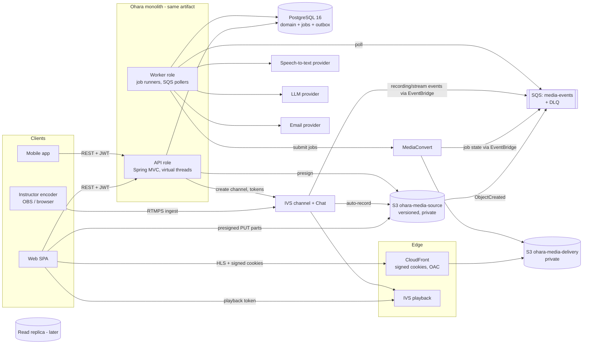

# 02 — Target Architecture

Status: **Proposed** · 2026-10-21 · Builds on `01-current-state-assessment.md`. Decisions are recorded as ADRs in `14-architecture-decision-records.md`.

## 1. Guiding principles

1. **One deployable, many modules.** Keep the Spring Modulith monolith. The same artifact runs in two roles: `api` (HTTP) and `worker` (job consumers). No microservices (ADR-001).
2. **Bytes never transit the JVM.** Uploads go browser → S3 (presigned); playback goes player → CloudFront → S3. The backend issues authorizations, never streams video.
3. **Separate the things that change independently:** identity ≠ membership ≠ enrollment ≠ entitlement ≠ payment ≠ progress; media readiness ≠ AI readiness.
4. **Durable state in PostgreSQL.** Jobs, outbox events and idempotency keys live in Postgres. SQS only carries external AWS events in. Kafka/Debezium is deferred until a consumer actually needs a log (ADR-008).
5. **Every external provider behind a port** (`ObjectStorage`, `Transcoder`, `CdnSigner`, `LiveStreamingProvider`, `SpeechToText`, `LlmClient`, `EmailSender`) with a mock adapter first, matching `initial_prompt.md`.
6. **Authorization is centralized** in `ContentAccessService` (resource access) and `OrgAuthorizationService` (administrative actions). Controllers never decide access by themselves.

## 2. Module map

| Module | Owns (tables) | Exposes (named interface) | Depends on |
|---|---|---|---|
| `auth` (existing) | `auth_identity`, `password_credential`, `refresh_token`, `one_time_token` | `AuthService`, `CurrentActor` | `user`, `notification` |
| `user` (existing) | `users`, `user_profile`, `user_role` (platform roles), `user_consent` | `UserService`, `User` | — |
| `organization` | `organization`, `organization_membership`, `cohort`, `cohort_membership`, `invitation`, `bulk_import_job`, `bulk_import_row` | `OrgAuthorizationService`, `MembershipQuery` | `user`, `notification`, `platform` |
| `course` | `course_category`, `course`, `course_instructor`, `course_version`, `course_module`, `lesson`, `lesson_content` | `CurriculumQuery`, `CoursePublishing` | `content` (asset refs), `organization` |
| `content` | `content_asset`, `media_upload`, `media_rendition` | `AssetQuery`, `AssetRegistration` | `platform` |
| `enrollment` | `course_offering`, `enrollment`, `access_grant`, `lesson_progress` | **`ContentAccessService`**, `EnrollmentService` | `course`, `organization` |
| `media` | (no tables of its own; drives `content` state + `processing_job`) | `PlaybackAuthorizationService` | `content`, `enrollment`, `platform` |
| `live` | `live_session`, `live_attendance` | `LiveSessionService` | `course`, `enrollment`, `content` |
| `ai` | `transcript_segment`, `lecture_chapter`, `lecture_artifact` | `LectureArtifactQuery`, `LectureQaService` | `content`, `enrollment` |
| `notification` | `notification_outbox` (optional, see 09) | `EmailSender` port | — |
| `platform` (shared kernel) | `processing_job`, `event_publication` (Modulith), `idempotency_key`, `audit_event` | `JobScheduler`, `AuditLog`, `Idempotency` | — |
| `common` (existing) | — | web error model, clock, ids | — |

Cross-module communication: synchronous calls through named interfaces for queries; **Spring Modulith application events** (`@ApplicationModuleListener`, persisted by the JDBC event publication registry) for side effects that must survive crashes — e.g. `CohortMembershipEnded` → enrollment revokes grants; `AssetReady` → course can publish; `LiveRecordingAvailable` → content registers asset.

## 3. High-level system architecture (diagram 1)

Redis is **not** on the critical path in the target design. It is kept optional for (a) login/OTP rate-limit counters and (b) a short-TTL access-decision cache if measurements show `ContentAccessService` hot (see `10-security-and-multitenancy.md` §6). If neither is adopted in a phase, remove the dependency to avoid a needless start-up/health coupling.

## 4. Component responsibilities

| Component | Responsibility | Not responsible for |
|---|---|---|
| API role | AuthN, authorization, domain writes, presigning, playback/live tokens, staff access grants | Transcoding, transcription, LLM calls, long polling |
| Worker role | Claims `processing_job` rows (`FOR UPDATE SKIP LOCKED`), polls SQS, calls providers, reconciles state, sends email, sweeps stale uploads/jobs | Serving user traffic |
| PostgreSQL | Source of truth incl. job state and outbox | Large blobs, chat history at scale |
| S3 source bucket | Immutable, versioned originals (uploads + live recordings) | Delivery |
| S3 delivery bucket | HLS renditions, thumbnails, captions (VTT), public-to-CDN only via OAC | Originals |
| CloudFront | Cached HLS delivery, signed-cookie enforcement | Business authorization (done by API before cookie issue) |
| MediaConvert | ABR HLS packaging, thumbnails | Validation that output is playable (worker verifies) |
| IVS | Live ingest, transcoding, distribution, chat transport, recording to S3 | Scheduling, attendance, who may join |
| STT / LLM providers | Transcripts, summaries, chapters, quiz drafts, Q&A answers | Access control, persistence |

## 5. Deployment view (initial)

- **Region:** `ap-south-1` (Mumbai) for app, DB and buckets [Assumption: India-first audience].
- **Compute:** containerised app on ECS Fargate (or 2–3 EC2 instances): `api` ×2 behind an ALB, `worker` ×1–2. Same image, role chosen by Spring profile (`ohara.role=api|worker`). Autoscale workers on `processing_job` backlog and SQS depth.
- **Database:** RDS PostgreSQL 16, Multi-AZ once paying customers exist; PITR enabled.
- **Secrets:** AWS Secrets Manager / SSM Parameter Store injected as env vars; no secrets in yml (fixes D6).
- **Environments:** `local` (compose + mocks), `dev` (real AWS sandbox), `prod`.
- **Local development:** all providers have mock adapters (`ohara.providers.*=mock`) so the full flow — upload → "transcode" → READY → playback — runs on a laptop.

## 6. Key trade-offs

| Decision | Benefit | Cost / risk | Mitigation |
|---|---|---|---|
| Monolith with worker role | One codebase, transactional consistency, simple ops | Worker deploys couple to API releases | Separate scaling + feature flags per job type |
| Postgres job table + Modulith outbox (no Kafka) | Exactly the durability we need, no new infra | Polling load; not a replayable log | `SKIP LOCKED`, partial indexes, backoff; revisit when analytics consumers appear |
| MediaConvert over FFmpeg | No encoder fleet to run; predictable per-minute cost | Vendor lock-in, Basic tier excludes some features | `Transcoder` port; ladder config in DB |
| CloudFront signed cookies | One authorization per playback session covers all segments | Cookie domain must match CDN alias; revocation lag = cookie TTL | Short TTL (10–30 min), refresh via API |
| IVS for live | Managed ingest + low latency + recording to S3 | Per-viewer-hour cost dominates at 100% attendance | Offer SD rendition default, measure attendance |
| Shared-schema multitenancy | Cheapest, simplest at 5 orgs | Bugs can leak cross-tenant | Central authorization, tenant-scoped repositories, isolation tests, optional RLS |

## 7. What is explicitly out of the target (for now)

**Online payments.** All payments (B2B contracts and B2C individuals) and refunds are handled offline by the contract team via bank transfer. Ohara stores no orders, payments or gateway credentials; access is granted and revoked by authorised staff with a reference to the contract/bank transaction (ADR-012). Also out: Kafka/Debezium, a vector database, DRM (Widevine/FairPlay), multi-region active-active, per-tenant databases, self-hosted FFmpeg fleet, custom CDN, microservices. Each has a re-evaluation trigger in `13-open-questions-and-decisions.md`.
