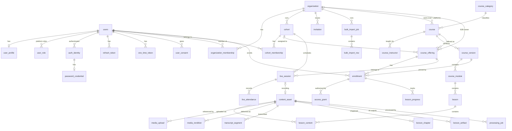

# 03 — Domain Model and Database Schema

Status: **Proposed** · PostgreSQL 16 · 2026-10-21

## 0. Conventions

- **Naming:** `snake_case`, singular table names (matches existing `user_profile`, `auth_identity`); `users` stays plural because `user` is reserved.
- **Keys:** `id UUID PRIMARY KEY`, generated by the application (Hibernate `GenerationType.UUID`, as today). Prefer UUIDv7 (time-ordered) for new tables to keep B-tree inserts local.
- **Time:** all new columns `TIMESTAMPTZ`, Java `Instant`. Existing `TIMESTAMP` columns are migrated in V3 (§13).
- **Audit columns** on mutable business tables: `created_at`, `updated_at` (NOT NULL, default `now()`), `created_by UUID NULL` (actor user id). `version INT NOT NULL DEFAULT 0` for optimistic locking where concurrent edits are plausible.
- **Enums:** `VARCHAR(32)` + `CHECK (col IN (...))` (matches `users.status`; easier to evolve than Postgres `ENUM`).
- **Deletes:** business rows are never hard-deleted while referenced by history. FKs default to `ON DELETE RESTRICT`. Soft state lives in `status` / `archived_at` / `left_at` / `revoked_at`.
- **Money:** `amount_minor BIGINT` + `currency CHAR(3)` (paise for INR).
- **JSONB:** only for provider payloads, settings, and non-relational metadata — never for core relationships.
- **Tenant column:** `organization_id` on tenant-owned rows. `NULL` organization on `course`/`content_asset` = platform-owned (B2C catalog).

Expected scale used for growth estimates (planning assumption, not a limit): 5 orgs, 10 cohorts, 5,000 B2B learners, 2,000–5,000 B2C MAU, ~100 new video-hours/month, ~87 live sessions/month.

---

## 1. Entity-relationship overview (diagram)



---

## 2. Identity (`user`, `auth` modules)

### 2.1 `users` (existing — modified)
- **Purpose:** one row per human; identity only, never enrollment.
- **Columns:** `id UUID PK`; `email VARCHAR(320) NOT NULL`; `email_verified_at TIMESTAMPTZ NULL` (denormalized from local identity for fast checks); `status VARCHAR(32) NOT NULL DEFAULT 'PENDING_VERIFICATION'`; `created_at`, `updated_at TIMESTAMPTZ NOT NULL`; `last_login_at TIMESTAMPTZ NULL`; `deactivated_at TIMESTAMPTZ NULL`; `anonymized_at TIMESTAMPTZ NULL`; `auth_version INT NOT NULL DEFAULT 0` (bumped on password reset / logout-all / suspension / email change; compared with the JWT `ver` claim — 04 §4). `first_name`/`last_name` move to `user_profile` (kept for one release, then dropped — D5).
- **Constraints:** `CHECK (status IN ('PENDING_VERIFICATION','ACTIVE','SUSPENDED','DEACTIVATED','ANONYMIZED'))`; replace `UNIQUE(email)` with `UNIQUE INDEX uq_users_email_lower ON users (lower(email))`. Existing `INACTIVE` rows map to `DEACTIVATED`.
- **Indexes:** the unique index above; nothing else (lookups are by id or email).
- **Cardinality:** ~10–20k rows in year 1.
- **Retention:** anonymization replaces email with `deleted+{id}@invalid`, clears profile, sets `ANONYMIZED`; row kept so FKs from orders/progress/attendance stay valid.
- **State rules:** see `04-registration-and-identity.md` §2.

### 2.2 `user_profile` (existing — modified)
`user_id UUID PK FK→users RESTRICT`; `display_name VARCHAR(128) NOT NULL`; `first_name VARCHAR(100) NOT NULL`; `last_name VARCHAR(100) NOT NULL`; **new:** `phone_e164 VARCHAR(20) NULL`, `avatar_asset_id UUID NULL FK→content_asset`, `locale VARCHAR(16) NOT NULL DEFAULT 'en-IN'`, `time_zone VARCHAR(64) NOT NULL DEFAULT 'Asia/Kolkata'`, `updated_at TIMESTAMPTZ NOT NULL`. 1:1 with users.

### 2.3 `user_role` (existing — narrowed)
Platform-level roles only: `CHECK (name IN ('ROLE_USER','ROLE_PLATFORM_ADMIN','ROLE_PLATFORM_SUPPORT','ROLE_ENROLLMENT_MANAGER'))` — `ROLE_ENROLLMENT_MANAGER` is the contract team: may grant/extend/revoke access for B2C offerings and record the offline payment reference, nothing else. Org roles live on `organization_membership`. Add `granted_at TIMESTAMPTZ`, `granted_by UUID`. Index `(user_id)` is covered by the existing unique `(user_id,name)`.

### 2.4 `auth_identity`, `password_credential` (existing — kept)
- `auth_identity.provider` `CHECK IN ('local','google','saml')` (future SSO for colleges). Add `created_at`. `UNIQUE(provider, identifier)` kept; for `local`, `identifier = lower(email)`.
- FK `user_id` → `ON DELETE RESTRICT`. On email change the `local` identity's `identifier` is updated in the same transaction as `users.email`.
- `password_credential` unchanged apart from `TIMESTAMPTZ` and RESTRICT FK. Add `failed_attempts INT NOT NULL DEFAULT 0`, `locked_until TIMESTAMPTZ NULL` (login throttling, D13).

### 2.5 `refresh_token` (existing — extended)
Add `family_id UUID NOT NULL` (all rotations of one login share it; reuse revokes the family — and, as today, all of the user's sessions when reuse is detected), `user_agent VARCHAR(256)`, `ip_hash VARCHAR(64)`. **Index** `ix_refresh_token_user_active ON refresh_token (user_id) WHERE revoked_at IS NULL` (serves `findByUserAndRevokedAtIsNull`, D8). Retention: purge rows 30 days after `expires_at` (job).

### 2.6 `one_time_token` (new)
- **Purpose:** email verification, password reset, email-change confirmation. Invitations have their own table (they exist before a user does).
- **Columns:** `id UUID PK`; `user_id UUID NOT NULL FK→users`; `purpose VARCHAR(32) NOT NULL CHECK IN ('EMAIL_VERIFICATION','PASSWORD_RESET','EMAIL_CHANGE')`; `token_hash VARCHAR(64) NOT NULL UNIQUE` (SHA-256 of 32 random bytes); `target_email VARCHAR(320) NULL` (email change); `expires_at TIMESTAMPTZ NOT NULL`; `consumed_at TIMESTAMPTZ NULL`; `created_at`.
- **Index:** `(user_id, purpose) WHERE consumed_at IS NULL` — invalidate older tokens on reissue.
- **Retention:** delete 7 days after expiry.

### 2.7 `user_consent` (new, minimal)

> **As built (V7, 2026-10-22):** `id, user_id, consent_type ∈ {TERMS, PRIVACY, MARKETING_EMAIL}, version, granted, source ∈ {SIGNUP, INVITATION, SETTINGS}, recorded_at`; append-only; current state = latest row per type. `AI_PROCESSING` is added when the AI phase needs it.

`id`, `user_id FK`, `consent_type VARCHAR(32) CHECK IN ('TERMS','PRIVACY','MARKETING_EMAIL','AI_PROCESSING')`, `version VARCHAR(16) NOT NULL`, `granted_at TIMESTAMPTZ NOT NULL`, `withdrawn_at TIMESTAMPTZ NULL`, `source VARCHAR(32)` (`SIGNUP`, `INVITE`, `SETTINGS`). Index `(user_id, consent_type)`. Append-only (new row per change) — legal evidence (DPDP Act, see 13).

---

## 3. Tenancy (`organization` module)

### 3.1 `organization`
- **Columns:** `id UUID PK`; `name VARCHAR(200) NOT NULL`; `slug VARCHAR(64) NOT NULL UNIQUE`; `type VARCHAR(32) NOT NULL CHECK IN ('COLLEGE','CORPORATE','OTHER')`; `status VARCHAR(32) NOT NULL DEFAULT 'ACTIVE' CHECK IN ('ACTIVE','SUSPENDED','ARCHIVED')`; `allowed_email_domains TEXT[] NULL` (optional auto-match on invite acceptance); `settings JSONB NOT NULL DEFAULT '{}'` (branding, default access duration); `contract_ref VARCHAR(128) NULL`; audit columns.
- **Cardinality:** tens. **Tenant:** is the tenant root. **Retention:** archive, never delete.

### 3.2 `organization_membership` (+ `organization_membership_role`)

> **As built (V5, 2026-10-21):** one row per *(organization, user)* — `UNIQUE (organization_id, user_id)` — with roles in a child table `organization_membership_role(membership_id, role)`; `status ∈ {ACTIVE, SUSPENDED, REMOVED}` (INVITED lives on `invitation`). Suspension/removal therefore applies to the person, member lists page cleanly, and the last-admin rule is one count. The per-role design below is superseded.

- **Purpose:** a user's relationship with an org and their org-scoped role(s).
- **Columns:** `id UUID PK`; `organization_id UUID NOT NULL FK`; `user_id UUID NOT NULL FK`; `role VARCHAR(32) NOT NULL CHECK IN ('ORG_ADMIN','INSTRUCTOR','LEARNER')`; `status VARCHAR(32) NOT NULL CHECK IN ('INVITED','ACTIVE','SUSPENDED','REMOVED')`; `external_ref VARCHAR(64) NULL` (college roll number); `joined_at`, `removed_at TIMESTAMPTZ NULL`; audit columns.
- **Constraints:** `UNIQUE (organization_id, user_id, role)` — a person can be both INSTRUCTOR and LEARNER in one org as two rows. `UNIQUE (organization_id, external_ref) WHERE external_ref IS NOT NULL`.
- **Indexes:** `(user_id) WHERE status='ACTIVE'` (my orgs, authorization); `(organization_id, role, status)` (admin lists).
- **Cardinality:** ~1 per B2B learner (~5k) + staff.
- **Rule:** membership grants *no* course access by itself.

### 3.3 `cohort`
`id`; `organization_id NOT NULL FK`; `name VARCHAR(200) NOT NULL`; `code VARCHAR(64) NOT NULL`; `starts_on DATE`, `ends_on DATE`; `status CHECK IN ('PLANNED','ACTIVE','COMPLETED','ARCHIVED')`; audit. `UNIQUE (organization_id, code)`. `CHECK (ends_on IS NULL OR ends_on >= starts_on)`. Index `(organization_id, status)`.

### 3.4 `cohort_membership`
- **Columns:** `id`; `cohort_id NOT NULL FK`; `user_id NOT NULL FK`; `organization_id NOT NULL` (denormalized for tenant-scoped queries; must equal cohort's org — enforced by composite FK `(cohort_id, organization_id) → cohort(id, organization_id)` with a `UNIQUE(id, organization_id)` on cohort); `status CHECK IN ('ACTIVE','TRANSFERRED','REMOVED','COMPLETED')`; `joined_at TIMESTAMPTZ NOT NULL`; `left_at TIMESTAMPTZ NULL`; `transferred_to_cohort_id UUID NULL`; audit.
- **Constraints:** one *active* membership per cohort: `UNIQUE (cohort_id, user_id) WHERE left_at IS NULL`. Learners may be in several cohorts (business rule, configurable per org via settings).
- **Indexes:** `(user_id) WHERE left_at IS NULL`; `(cohort_id) WHERE left_at IS NULL`.
- **Retention:** never deleted; removal sets `left_at` → history and reports survive.

### 3.5 `invitation`

> **As built (V6, 2026-10-21):** one role per invitation; optional `first_name/last_name` (prefill) and `external_ref`; `UNIQUE (organization_id, lower(email)) WHERE status='PENDING'` (re-inviting rotates the token on the same row); composite FK to `cohort(id, organization_id)`; `CHECK (cohort_id IS NULL OR role='LEARNER')`; expiry 14 days, evaluated lazily (`expireIfDue`) — no sweeper needed yet.

- **Columns:** `id`; `organization_id NOT NULL FK`; `cohort_id NULL FK`; `email VARCHAR(320) NOT NULL`; `role VARCHAR(32) NOT NULL`; `token_hash VARCHAR(64) NOT NULL UNIQUE`; `status CHECK IN ('PENDING','ACCEPTED','EXPIRED','REVOKED')`; `expires_at TIMESTAMPTZ NOT NULL`; `accepted_by_user_id UUID NULL`; `accepted_at`; `bulk_import_row_id UUID NULL`; `invited_by UUID NOT NULL`; `send_count INT NOT NULL DEFAULT 0`; `last_sent_at`; audit.
- **Constraints:** `UNIQUE (organization_id, lower(email), role) WHERE status='PENDING'` (resending reuses the row, rotating `token_hash`).
- **Indexes:** `(organization_id, status)`; `(lower(email)) WHERE status='PENDING'` (auto-attach on signup).
- **Expiry:** sweeper marks `EXPIRED`; acceptance checks `expires_at` regardless.

### 3.6 `bulk_import_job` / `bulk_import_row`

> **As built (V6):** the CSV is uploaded directly (multipart, ≤ 1 MB / 5,000 rows, UTF-8) and parsed into rows at upload — no S3 object yet; job statuses `VALIDATED → PROCESSING → COMPLETED | COMPLETED_WITH_ERRORS`, or `CANCELLED`; row statuses add `INVALID` (rejected at upload) and `CANCELLED`; error report is generated on demand (`GET …/errors.csv`). Uniqueness on `file_sha256` excludes cancelled imports.

- `bulk_import_job`: `id`; `organization_id`; `cohort_id NULL`; `uploaded_by`; `source_object_key VARCHAR(512)` (S3, private); `file_sha256 CHAR(64)`; `status CHECK IN ('UPLOADED','VALIDATING','VALIDATED','PROCESSING','COMPLETED','COMPLETED_WITH_ERRORS','FAILED','CANCELLED')`; `total_rows`, `succeeded_rows`, `failed_rows INT`; `error_report_key VARCHAR(512) NULL`; `mode CHECK IN ('INVITE','CREATE_ACCOUNTS','GRANT_ACCESS')` (`GRANT_ACCESS`: contract team bulk-enrolls paid B2C learners into one `course_offering`, with a per-row `external_reference`); `course_offering_id UUID NULL` (GRANT_ACCESS only); `organization_id` nullable for GRANT_ACCESS jobs; audit. `UNIQUE (organization_id, file_sha256) WHERE status NOT IN ('FAILED','CANCELLED')` (accidental double upload).
- `bulk_import_row`: `id`; `job_id FK`; `row_number INT`; `email`, `first_name`, `last_name`, `external_ref` (roll number, or contract/bank reference for GRANT_ACCESS); `status CHECK IN ('PENDING','INVITED','LINKED_EXISTING','CREATED','SKIPPED_DUPLICATE','FAILED')`; `error_code VARCHAR(64)`, `error_detail VARCHAR(500)`; `user_id NULL`; `invitation_id NULL`. `UNIQUE (job_id, row_number)`; index `(job_id, status)`. Rows retained 90 days, then purged (job summary kept).

---

## 4. Catalog and curriculum (`course` module)

> **As built (V8, 2026-10-30):** `course`, `course_instructor`, `course_version`, `course_module`, `lesson`, `lesson_content`. Differences from the design below: `course_category` deferred (no catalog search yet); `lesson_content.kind ∈ {TEXT, EXTERNAL_LINK}` with an inline `body` for TEXT and `course_version_id` denormalized (for the trigger) — asset-backed kinds and the `content_asset_id` FK come in R3; `settings JSONB` deferred. Immutability is enforced by triggers: curriculum rows of a non-DRAFT version can't be inserted/updated/deleted, and a published version may only move to ARCHIVED.


### 4.1 `course_category`
`id`, `slug UNIQUE`, `name`, `parent_id NULL FK self`, `sort_order INT`. Tens of rows.

### 4.2 `course`
- **Purpose:** the stable learning product identity (title/slug survive versions).
- **Columns:** `id`; `owner_organization_id UUID NULL FK` (NULL = platform catalog; non-null = private org course); `slug VARCHAR(128) NOT NULL`; `title VARCHAR(200) NOT NULL`; `category_id NULL FK`; `status CHECK IN ('DRAFT','ACTIVE','RETIRED')`; `current_published_version_id UUID NULL FK→course_version` (deferrable); `visibility CHECK IN ('PUBLIC','ORG_PRIVATE','UNLISTED')`; audit + `version`.
- **Constraints:** `UNIQUE (slug)` for platform courses; `UNIQUE (owner_organization_id, slug)` for org courses (two partial unique indexes). `CHECK (visibility <> 'ORG_PRIVATE' OR owner_organization_id IS NOT NULL)`.
- **Indexes:** `(status, visibility)` for discovery; full-text `GIN (to_tsvector('simple', title))` once catalog search exists.

### 4.3 `course_instructor`
`course_id FK`, `user_id FK`, `role CHECK IN ('OWNER','INSTRUCTOR','TA')`, `added_at`. PK `(course_id, user_id)`. Index `(user_id)` (my courses). Authorization for editing.

### 4.4 `course_version`
- **Purpose:** a snapshot of curriculum. Published versions are **immutable**.
- **Columns:** `id`; `course_id NOT NULL FK`; `version_number INT NOT NULL`; `status CHECK IN ('DRAFT','PUBLISHED','ARCHIVED')`; `title VARCHAR(200)`, `subtitle`, `description TEXT`, `language VARCHAR(16)`, `level VARCHAR(16)`; `thumbnail_asset_id NULL FK`; `estimated_minutes INT`; `published_at`, `published_by`; `based_on_version_id NULL FK self`; `change_notes TEXT`; audit.
- **Constraints:** `UNIQUE (course_id, version_number)`; at most one draft: `UNIQUE (course_id) WHERE status='DRAFT'`.
- **Index:** `(course_id, status)`.
- **Immutability:** enforced in the service and by a trigger rejecting UPDATE of curriculum rows whose version is `PUBLISHED` (defence in depth).

### 4.5 `course_module`
`id`; `course_version_id NOT NULL FK ON DELETE CASCADE` (drafts only — RESTRICT for published via trigger); `module_key UUID NOT NULL` (stable across versions); `title`; `position INT NOT NULL`; `UNIQUE (course_version_id, position) DEFERRABLE INITIALLY DEFERRED` (reorder in one transaction); `UNIQUE (course_version_id, module_key)`.

### 4.6 `lesson`
- **Columns:** `id`; `course_module_id NOT NULL FK`; `course_version_id NOT NULL` (denormalized for one-query curriculum load); `lesson_key UUID NOT NULL` (**stable identity across versions — progress maps by this**); `title`; `type CHECK IN ('VIDEO','READING','QUIZ','ASSIGNMENT','LIVE','MIXED')`; `position INT NOT NULL`; `is_preview BOOLEAN NOT NULL DEFAULT false` (free preview for B2C discovery); `duration_seconds INT NULL`; audit.
- **Constraints:** `UNIQUE (course_module_id, position) DEFERRABLE INITIALLY DEFERRED`; `UNIQUE (course_version_id, lesson_key)`.
- **Indexes:** `(course_version_id)`; `(lesson_key)` (progress mapping across versions).

### 4.7 `lesson_content`
- **Purpose:** association between a lesson and a reusable asset (or inline item).
- **Columns:** `id`; `lesson_id NOT NULL FK`; `content_asset_id UUID NULL FK→content_asset RESTRICT`; `kind CHECK IN ('VIDEO','DOCUMENT','QUIZ','ASSIGNMENT','EXTERNAL_LINK','TRANSCRIPT','AI_ARTIFACT')`; `external_url VARCHAR(2048) NULL`; `title_override VARCHAR(200)`; `position INT NOT NULL`; `is_required BOOLEAN NOT NULL DEFAULT true`; `settings JSONB` (e.g. quiz pass mark).
- **Constraints:** `CHECK ((kind='EXTERNAL_LINK') = (external_url IS NOT NULL))`; `CHECK (kind='EXTERNAL_LINK' OR content_asset_id IS NOT NULL)`; `UNIQUE (lesson_id, position) DEFERRABLE`.
- **Index:** `(content_asset_id)` — "where is this asset used?" (reuse / safe delete).
- **Rule:** deleting a lesson deletes its `lesson_content` rows; the asset is untouched (RESTRICT means an asset can't be deleted while referenced).

Quiz/assignment question banks are intentionally not modeled here; they are a later module (`assessment`) that reuses `content_asset` with `asset_type='QUIZ'` as the container. See 13 (Q-12).

---

## 5. Content assets (`content` module)

> **As built (V11, 2026-10-31):** `content_asset` (adds `original_filename`, `mime_type`, `content_profile`; `asset_type ∈ {VIDEO, DOCUMENT, IMAGE}`; `live_session_id`/`origin`/`replaced_by_asset_id` deferred to R4) and `media_upload` (`storage_upload_id`, `part_count`, `client_key` for idempotent start). `lesson_content` gained kinds `VIDEO`, `DOCUMENT` with a RESTRICT FK to `content_asset`. `media_rendition` comes with the processing pipeline.


### 5.1 `content_asset`
- **Purpose:** a physical, reusable piece of content, independent of curriculum.
- **Columns:** `id`; `owner_organization_id UUID NULL FK` (NULL = platform); `asset_type CHECK IN ('VIDEO','DOCUMENT','IMAGE','QUIZ','AUDIO')`; `title VARCHAR(200)`; `media_status VARCHAR(32) NOT NULL` (state machine §5.4; for non-video `PENDING_UPLOAD→UPLOADED→READY`); `source_object_key VARCHAR(512) NULL`; `source_version_id VARCHAR(128) NULL` (S3 object version — the immutable input version AI and transcodes reference); `source_sha256 CHAR(64) NULL`; `source_bytes BIGINT`, `mime_type VARCHAR(128)`; `duration_ms BIGINT NULL`; `width INT`, `height INT`, `frame_rate NUMERIC(6,3)`; `delivery_prefix VARCHAR(512) NULL` (e.g. `org/{org}/asset/{id}/v{n}/`); `master_playlist_key VARCHAR(512) NULL`; `processing_generation INT NOT NULL DEFAULT 0` (increments on every reprocess; delivery path includes it); `replaced_by_asset_id UUID NULL FK self`; `origin CHECK IN ('UPLOAD','LIVE_RECORDING','IMPORT')`; `live_session_id UUID NULL`; `failure_code VARCHAR(64)`, `failure_detail VARCHAR(1000)`; `ready_at`; `retired_at`; audit + `version`.
- **Indexes:** `(owner_organization_id, asset_type, created_at DESC)` (library listing); `(media_status) WHERE media_status IN ('UPLOADED','PROCESSING')` (sweeper); `UNIQUE (live_session_id) WHERE live_session_id IS NOT NULL` (one recording asset per session — idempotent registration).
- **Cardinality:** ~100–300 videos/month + documents.
- **Retention:** `RETIRED` assets keep source in Glacier-class storage per policy (06 §4); never hard-deleted while `lesson_content` references exist.

### 5.2 `media_upload`
- **Purpose:** one upload attempt (multipart session) for an asset.
- **Columns:** `id`; `content_asset_id NOT NULL FK`; `status CHECK IN ('INITIATED','COMPLETED','ABORTED','EXPIRED')`; `s3_upload_id VARCHAR(256) NULL`; `object_key VARCHAR(512) NOT NULL`; `declared_bytes BIGINT NOT NULL`; `declared_mime VARCHAR(128)`; `declared_sha256 CHAR(64) NULL`; `part_size_bytes INT`; `expires_at TIMESTAMPTZ NOT NULL`; `completed_at`; `initiated_by UUID NOT NULL`; `client_idempotency_key VARCHAR(64) NOT NULL`; audit.
- **Constraints:** `UNIQUE (initiated_by, client_idempotency_key)` — retried "initiate" returns the same upload. `UNIQUE (content_asset_id) WHERE status='INITIATED'`.
- **Index:** `(status, expires_at) WHERE status='INITIATED'` (abandoned-upload sweeper).

### 5.3 `media_rendition`
`id`; `content_asset_id FK`; `processing_generation INT NOT NULL`; `kind CHECK IN ('HLS_VARIANT','THUMBNAIL','CAPTION_VTT','AUDIO_ONLY','DOWNLOAD_MP4')`; `height INT NULL`; `bitrate_kbps INT NULL`; `codec VARCHAR(32)`; `object_key VARCHAR(512) NOT NULL`; `bytes BIGINT`; `language VARCHAR(16) NULL` (captions); `verified_at TIMESTAMPTZ NULL`. `UNIQUE (content_asset_id, processing_generation, kind, height, language)`. Supports "is every expected rendition present?" before READY.

### 5.4 Media state machine

```
PENDING_UPLOAD → UPLOADED → PROCESSING → READY
      │             │           │  └──→ FAILED ──(retry)──→ PROCESSING
      └→ CANCELLED  └→ REJECTED (validation)          READY → RETIRED
```
`READY` only after the worker verifies master + variant playlists and at least one segment per variant exist (09 §5). `REJECTED` = invalid file (wrong container, too long, malware flagged); requires a new upload. `FAILED` keeps the source so retry needs no re-upload.

---

## 6. Enrollment, access and progress (`enrollment` module)

> **As built (V9, 2026-10-31):** `course_offering`, `enrollment`, `access_grant` as designed, with: offering `title`; grant uniqueness is `(enrollment_id, source, source_ref_id)` (one cohort placement can feed several offerings); `scope` column dropped (preview is a lesson flag); `revoked_by` added. `lesson_progress` built in V10 (2026-10-31): status `IN_PROGRESS|COMPLETED` (no row = not started), `created_at` added; heartbeats take a row lock instead of an UPSERT.


### 6.1 `course_offering`
- **Purpose:** *how* a course is delivered to a population: B2B (org + optional cohort + window) or B2C (public listing + price).
- **Columns:** `id`; `course_id NOT NULL FK`; `channel CHECK IN ('B2B','B2C')`; `organization_id UUID NULL FK`; `cohort_id UUID NULL FK`; `version_policy CHECK IN ('PINNED','LATEST_ON_ENROLL')` default `LATEST_ON_ENROLL`; `pinned_course_version_id NULL FK`; `starts_at TIMESTAMPTZ NULL`, `ends_at TIMESTAMPTZ NULL`; `access_duration_days INT NULL` (B2C: access length after the grant starts; NULL = lifetime of offering); `list_price_minor BIGINT NULL`, `currency CHAR(3) NULL` (**display only** — payment happens offline; Ohara never charges); `status CHECK IN ('DRAFT','OPEN','CLOSED','ARCHIVED')`; `seat_limit INT NULL`; audit.
- **Constraints:** `CHECK (channel='B2B' AND organization_id IS NOT NULL OR channel='B2C' AND organization_id IS NULL)`; `CHECK (version_policy='LATEST_ON_ENROLL' OR pinned_course_version_id IS NOT NULL)`; `UNIQUE (course_id, cohort_id) WHERE cohort_id IS NOT NULL AND status <> 'ARCHIVED'`.
- **Indexes:** `(organization_id, status)`; `(cohort_id)`; `(channel, status)` for B2C catalog.

### 6.2 `enrollment`
- **Columns:** `id`; `user_id NOT NULL FK`; `course_offering_id NOT NULL FK`; `course_id NOT NULL` (denormalized for "my courses"); `organization_id UUID NULL` (copied from offering, tenant scoping); `course_version_id NOT NULL FK` (pinned at enrollment); `status CHECK IN ('ACTIVE','SUSPENDED','COMPLETED','EXPIRED','REVOKED','CANCELLED')`; `enrolled_at`, `completed_at`, `ended_at`; `progress_percent NUMERIC(5,2) NOT NULL DEFAULT 0` (cached); `last_activity_at`; audit + `version`.
- **Constraints:** `UNIQUE (user_id, course_offering_id)` — the idempotency anchor for both B2B cohort assignment and staff-granted B2C access.
- **Indexes:** `(user_id, status)` (dashboard); `(course_offering_id, status)` (cohort reports); `(organization_id, course_id)` (org reports).
- **Cardinality:** B2B ≈ learners × courses (5k × ~4 = 20k/yr); B2C a few thousand.
- **Retention:** permanent (learning record).

### 6.3 `access_grant`
- **Purpose:** the *reason* a user may access an enrollment's content, with its own window. Multiple grants may coexist (e.g. cohort assignment + admin extension).
- **Columns:** `id`; `enrollment_id NOT NULL FK`; `user_id NOT NULL` (denormalized for the hot authorization query); `source CHECK IN ('COHORT_ASSIGNMENT','CONTRACT','ADMIN_GRANT','PROMOTION')` (`CONTRACT` = access paid for offline and recorded by the contract team; `ADMIN_GRANT` = complimentary/extension); `source_ref_id UUID NULL` (cohort_membership id, bulk_import_row id, …); `external_reference VARCHAR(128) NULL` (contract number / bank UTR — **required when `source='CONTRACT'`**, `CHECK (source <> 'CONTRACT' OR external_reference IS NOT NULL)`); `note VARCHAR(500) NULL`; `scope CHECK IN ('FULL','PREVIEW')`; `valid_from TIMESTAMPTZ NOT NULL`; `valid_until TIMESTAMPTZ NULL`; `revoked_at TIMESTAMPTZ NULL`; `revoked_reason VARCHAR(64)` (`REMOVED_FROM_COHORT`, `REFUNDED_OFFLINE`, `CONTRACT_ENDED`, `ADMIN`, …); `revoked_by UUID NULL`; `granted_by UUID NULL`; `created_at`.
- **Constraints:** `UNIQUE (source, source_ref_id) WHERE source_ref_id IS NOT NULL` — **a cohort membership or import row can create at most one grant** (retry-safe). Staff single grants are made idempotent by the `Idempotency-Key` header (08 §1.5). `CHECK (valid_until IS NULL OR valid_until > valid_from)`.
- **Index:** `(user_id, enrollment_id) WHERE revoked_at IS NULL` — the authorization check (`ContentAccessService`) is "exists active grant with now() in window" for this enrollment.
- **Retention:** permanent, append-mostly (revocation is an update of `revoked_at`, never a delete) → doubles as access history; separate `enrollment_audit` table not needed.

### 6.4 `lesson_progress`
- **Purpose:** unified progress + video resume (one row per user × lesson identity).
- **Columns:** `id`; `user_id NOT NULL`; `enrollment_id NOT NULL FK`; `lesson_key UUID NOT NULL` (version-independent); `lesson_id UUID NOT NULL` (the version-specific row last seen); `status CHECK IN ('NOT_STARTED','IN_PROGRESS','COMPLETED')`; `video_position_ms BIGINT NULL`; `video_duration_ms BIGINT NULL`; `watched_ms BIGINT NOT NULL DEFAULT 0` (sum of unique watched intervals, coarse); `completed_at`; `updated_at`; `client_updated_at TIMESTAMPTZ` (last-write-wins guard).
- **Constraints:** `UNIQUE (enrollment_id, lesson_key)`.
- **Index:** `(user_id, updated_at DESC)` (continue watching).
- **Write pattern:** heartbeat every 15–30 s while playing → UPSERT `ON CONFLICT (enrollment_id, lesson_key) DO UPDATE ... WHERE excluded.client_updated_at > lesson_progress.client_updated_at`. At 1,000 concurrent viewers ÷ 20 s ≈ 50 writes/s — fine for Postgres; batch via client debounce. No Redis needed.
- **Retention:** permanent.

---

## 7. Payments — not modeled (offline)

**Decision (2026-10-21, ADR-012):** all payments and refunds — B2B contracts and B2C individuals — are handled by the contract team outside Ohara, by bank transfer. Ohara therefore has **no** `purchase_order`, `order_item`, `payment_transaction`, `payment_webhook_event` or `subscription` tables, no gateway integration and no checkout.

What Ohara keeps is the link from access to the commercial record:
- `access_grant.source = 'CONTRACT'` with mandatory `external_reference` (contract no. / bank UTR), `granted_by`, `valid_from/valid_until`.
- B2B: the contract is reflected by the org's licence (`organization.settings.licensed_course_ids`, Q-03) and offering windows; no per-learner money record.
- Refund: contract team revokes the grant (`revoked_reason='REFUNDED_OFFLINE'`, `revoked_by`); progress stays.
- Audit: every grant/extend/revoke writes `audit_event` with the reference, so finance can reconcile Ohara access against bank records via the report `GET /api/admin/access-grants?source=CONTRACT&from&to` (CSV).

If online payment is ever introduced, the earlier commerce design (order, item, transaction, webhook-event tables with gateway-id uniqueness) can be added as a new module emitting grants with a new `source` value — the access model doesn't change.

## 8. Live classes (`live` module)

### 8.1 `live_session`
- **Columns:** `id`; `organization_id UUID NULL` (B2B; NULL for platform webinars); `cohort_id UUID NULL FK`; `course_offering_id NOT NULL FK`; `lesson_id UUID NULL FK` (curriculum slot); `title`; `host_user_id NOT NULL FK`; `scheduled_start TIMESTAMPTZ NOT NULL`; `scheduled_end TIMESTAMPTZ NOT NULL`; `status CHECK IN ('SCHEDULED','READY','LIVE','ENDED','CANCELLED','RECORDING_PROCESSING','RECORDING_READY','RECORDING_FAILED')`; `provider VARCHAR(16) DEFAULT 'IVS'`; `provider_channel_arn VARCHAR(256)`; `provider_chat_room_arn VARCHAR(256)`; `ingest_endpoint VARCHAR(256)`; `stream_key_secret_ref VARCHAR(256)` (pointer to Secrets Manager/provider — **never the key itself**); `actual_start`, `actual_end`; `peak_concurrent_viewers INT`; `recording_asset_id UUID NULL FK→content_asset`; `cancelled_reason`; audit + `version`.
- **Constraints:** `CHECK (scheduled_end > scheduled_start)`; `EXCLUDE USING gist (host_user_id WITH =, tstzrange(scheduled_start, scheduled_end) WITH &&) WHERE (status NOT IN ('CANCELLED'))` (no double-booked host; needs `btree_gist`).
- **Indexes:** `(cohort_id, scheduled_start)` (cohort calendar); `(status, scheduled_start)` (pre-start provisioning job).
- **Cardinality:** ~90/month.

### 8.2 `live_attendance`
- **Purpose:** aggregated attendance per user per session — not raw player events.
- **Columns:** `live_session_id FK`, `user_id FK`, PK `(live_session_id, user_id)`; `first_joined_at`, `last_seen_at`; `join_count INT`; `attended_seconds INT NOT NULL DEFAULT 0`; `attendance_status CHECK IN ('PRESENT','PARTIAL','ABSENT')` (computed at session end with org threshold, e.g. ≥ 60% of duration); `source CHECK IN ('PLAYER_HEARTBEAT','MANUAL')`.
- **Write pattern:** player heartbeat every 60 s → UPSERT incrementing `attended_seconds` (capped by wall-clock since `last_seen_at`). 500 viewers → ~8 writes/s.
- **Retention:** permanent (college reporting).

Chat messages are **not** stored by default (IVS Chat is ephemeral). If moderation/audit requires it (Q-05), add `live_chat_message(id, live_session_id, user_id, body VARCHAR(1000), sent_at, moderation_status)` partitioned by month.

---

## 9. AI artifacts (`ai` module)

### 9.1 `transcript_segment`
`id BIGSERIAL` (high-volume, internal); `content_asset_id FK`; `source_version_id VARCHAR(128) NOT NULL`; `transcript_version INT NOT NULL`; `seq INT`; `start_ms`, `end_ms BIGINT`; `speaker VARCHAR(32) NULL`; `text TEXT NOT NULL`; `confidence NUMERIC(4,3)`; `tsv TSVECTOR GENERATED ALWAYS AS (to_tsvector('english', text)) STORED`. `UNIQUE (content_asset_id, transcript_version, seq)`. Indexes: `GIN (tsv)`; `(content_asset_id, transcript_version, start_ms)`. Volume: ~1 segment per 5–10 s → ~500 rows/hour of video → ~100k rows/yr. Old transcript versions retained 90 days after supersession.
- Add column `embedding vector(…)` + HNSW index **only** if Q&A evaluation shows FTS retrieval is insufficient (pgvector, ADR-010).

### 9.2 `lecture_chapter`
`id`; `content_asset_id FK`; `artifact_id FK→lecture_artifact`; `start_ms`; `title VARCHAR(200)`; `seq`. `UNIQUE (artifact_id, seq)`.

### 9.3 `lecture_artifact`
- **Columns:** `id`; `content_asset_id NOT NULL FK`; `artifact_type CHECK IN ('TRANSCRIPT','CAPTIONS','SUMMARY','CHAPTERS','QUIZ_DRAFT','FLASHCARDS','KEY_CONCEPTS')`; `source_version_id VARCHAR(128) NOT NULL`; `transcript_version INT NULL`; `artifact_version INT NOT NULL`; `status CHECK IN ('GENERATED','IN_REVIEW','APPROVED','REJECTED','SUPERSEDED')`; `content JSONB NOT NULL` (structured output validated against a JSON schema per type); `object_key VARCHAR(512) NULL` (VTT/large outputs in S3); `provider VARCHAR(32)`, `model VARCHAR(64)`, `prompt_template_version VARCHAR(32)`; `input_tokens INT`, `output_tokens INT`, `audio_seconds INT`, `cost_micro_usd BIGINT`; `processing_job_id UUID`; `edited_by UUID NULL`, `edited_at TIMESTAMPTZ NULL` (instructor edits of a draft); `reviewed_by`, `reviewed_at`; `created_at`.
- **Constraints:** `UNIQUE (content_asset_id, artifact_type, artifact_version)`; one approved per type: `UNIQUE (content_asset_id, artifact_type) WHERE status='APPROVED'`.
- **Visibility rule:** learners see only `APPROVED` (or `GENERATED` for types the org configured as auto-publish, e.g. captions).

### 9.4 `ai_qa_log` (Phase 5b, only when Q&A ships)
`id`; `user_id FK`; `organization_id NULL`; `course_id`; `question_sha256 CHAR(64)` (question text stored only if the org opts in for quality review); `retrieved_asset_ids UUID[]`; `model VARCHAR(64)`; `input_tokens`, `output_tokens INT`; `cost_micro_usd BIGINT`; `grounded BOOLEAN`; `citation_count SMALLINT`; `feedback SMALLINT NULL` (−1/+1); `created_at`. Index `(organization_id, created_at)`, `(user_id, created_at)` (per-user daily limit). Retention 90 days; deleted on account anonymization.

---

## 10. Platform (`platform` module)

### 10.1 `processing_job`
- **Purpose:** durable, idempotent background work for media, AI, imports, email, sweeps.
- **Columns:** `id UUID PK`; `job_type VARCHAR(48) NOT NULL` (e.g. `MEDIA_PROBE`, `MEDIA_TRANSCODE`, `MEDIA_VERIFY`, `AI_TRANSCRIBE`, `AI_SUMMARIZE`, `AI_CHAPTERS`, `AI_QUIZ`, `BULK_IMPORT`, `EMAIL_SEND`, `LIVE_RECORDING_INGEST`); `subject_type VARCHAR(32)`, `subject_id UUID`; `idempotency_key VARCHAR(200) NOT NULL UNIQUE` (e.g. `AI_SUMMARIZE:{asset}:{source_version}:{prompt_v}`); `status CHECK IN ('PENDING','RUNNING','WAITING_EXTERNAL','SUCCEEDED','FAILED','DEAD','CANCELLED')`; `priority SMALLINT DEFAULT 5`; `attempt INT NOT NULL DEFAULT 0`; `max_attempts INT NOT NULL DEFAULT 5`; `run_after TIMESTAMPTZ NOT NULL DEFAULT now()`; `locked_by VARCHAR(64)`, `lease_until TIMESTAMPTZ`; `external_ref VARCHAR(256)` (MediaConvert job id, STT job id); `payload JSONB`; `result JSONB`; `last_error_code`, `last_error VARCHAR(2000)`; `parent_job_id UUID NULL`; `created_at`, `updated_at`, `finished_at`.
- **Indexes:** `ix_job_ready ON processing_job (priority, run_after) WHERE status='PENDING'` (claim query); `(status, lease_until) WHERE status='RUNNING'` (lease-expiry recovery); `(subject_type, subject_id)`; `(external_ref) WHERE external_ref IS NOT NULL` (map provider callbacks).
- **Retention:** succeeded jobs purged after 30 days (aggregate metrics retained); DEAD kept 180 days.

### 10.2 `event_publication`
Created/managed by Spring Modulith's JDBC event publication registry (`spring-modulith-starter-jdbc`) — transactional outbox for module events. Completed publications purged after 7 days.

### 10.3 `idempotency_key`
`key VARCHAR(64)`, `actor_user_id UUID`, `endpoint VARCHAR(128)`, `request_hash CHAR(64)`, `response_status INT`, `response_body JSONB`, `created_at`, `expires_at`. PK `(actor_user_id, endpoint, key)`. For `Idempotency-Key` on POSTs that create money/access/upload side effects (08 §1.5). TTL 24 h.

### 10.4 `audit_event`
`id BIGSERIAL`; `occurred_at TIMESTAMPTZ`; `actor_user_id UUID NULL`; `actor_type CHECK IN ('USER','SYSTEM')`; `organization_id UUID NULL`; `action VARCHAR(64)` (e.g. `ENROLLMENT_REVOKED`, `ROLE_GRANTED`, `COURSE_PUBLISHED`, `ACCESS_DENIED_CROSS_TENANT`); `resource_type`, `resource_id`; `ip_hash`, `user_agent`; `details JSONB`. Indexes `(organization_id, occurred_at DESC)`, `(resource_type, resource_id)`. Append-only (no UPDATE/DELETE grants for the app role). Monthly range partitioning once > ~10M rows. Retention 2 years (configurable).

---

## 11. Answers to the key modeling questions

| Question | Answer | Rationale |
|---|---|---|
| Separate `student` table? | **No.** Learner = `users` + `user_profile` + `organization_membership(role=LEARNER)` + `cohort_membership` + `enrollment`. | "Student" is a role in a context, not an identity; a separate table forces duplicates when a learner is also an instructor or B2C buyer. College-specific attributes (roll number) live on the membership (`external_ref`). |
| Same user with B2B and B2C access? | **Yes.** One `users` row; B2B enrollment via a B2B offering + `COHORT_ASSIGNMENT` grant; B2C via B2C offering + staff-recorded `CONTRACT` grant (paid offline). | `access_grant.source` distinguishes them; reports filter by `course_offering.channel`. |
| One course to multiple colleges? | **Yes.** One `course`, many `course_offering` rows (one per org/cohort). | Content is authored once; delivery windows/pricing differ per offering. |
| Learner in multiple cohorts? | **Yes**, allowed by schema; restricted per org via `organization.settings.max_active_cohorts_per_learner`. | Electives / repeaters exist; uniqueness is per cohort. |
| Asset reused across lessons? | **Yes.** `lesson_content` → `content_asset` many-to-one; RESTRICT FK prevents deleting a used asset. | Single physical copy, single transcode, single AI cost. |
| Course versions vs active enrollments? | Enrollment pins `course_version_id` at enrollment time (offering `version_policy`). Learners are moved to a new version only by explicit migration; progress maps by `lesson_key`. | Published versions are immutable, so a learner's curriculum never changes under them unexpectedly. |
| Revoked entitlement vs cached playback auth? | Playback cookies/tokens have short TTL (≤ 30 min VOD, live token ≤ session length but join re-checked). Revocation sets `access_grant.revoked_at`; next cookie refresh fails. Optional: CloudFront key-group rotation for emergency kill. | Bounded revocation lag; see 10 §5. |
| Deleted/deactivated users in history? | Rows are never deleted; `users.status=ANONYMIZED` with scrubbed PII; FKs remain valid; reports show "Deleted user". | Preserves financial, attendance and progress integrity. |
| Historical attendance and progress preserved? | `live_attendance`, `lesson_progress`, `enrollment`, `cohort_membership(left_at)` are append/soft-state only; removal from cohort ends grants (`revoked_at`) but keeps records. | Colleges need historical reports after courses end. |

---

## 12. Tenant isolation summary

| Table group | Tenant key | Enforcement |
|---|---|---|
| organization, membership, cohort, cohort_membership, invitation, bulk_import_* | `organization_id` | `OrgAuthorizationService` + repository methods that require `organizationId` |
| course / content_asset | `owner_organization_id` (nullable) | Editing: course_instructor/ORG_ADMIN of owner; viewing: via enrollment + grant |
| course_offering, enrollment, live_session | `organization_id` (nullable for B2C) | `ContentAccessService`; admin reports scoped by org |
| access_grant, lesson_progress, live_attendance | via `enrollment`/`user_id` | Always queried with `user_id = actor` or by org admin through enrollment join |
| AI artifacts / transcripts | via `content_asset` | Same check as the asset; Q&A retrieval filters by accessible asset ids |

Optional later hardening: Postgres RLS policies on `organization_id` using `SET LOCAL app.org_ids` — evaluated in ADR-002.

---

## 13. Migration strategy

Flyway, forward-only, one concern per script; each lands with the code that uses it.

| Version | Content | Risk |
|---|---|---|
| V3__identity_hardening ✅ (2026-10-21) | `TIMESTAMP`→`TIMESTAMPTZ`, cascades → RESTRICT, `users.status` CHECK (+ `INACTIVE→DEACTIVATED`), `auth_version`, `lower(email)` unique index, partial index `refresh_token(user_id) WHERE revoked_at IS NULL` | Applied to dev + test DBs; entities now use `Instant`. |
| V3_1__account_lifecycle ✅ (2026-10-21) | `email_verified_at` (existing ACTIVE users backfilled), status default `PENDING_VERIFICATION`, `one_time_token` (EMAIL_VERIFICATION, PASSWORD_RESET), `password_credential.failed_attempts/locked_until` | Applied to dev + test DBs. `user_consent` and `refresh_token.family_id` deferred until consents / per-device sessions are built. |
| V5__organization ✅ (2026-10-21) | organization, organization_membership (+ `_role`), cohort, cohort_membership (composite FK keeps placements inside the cohort's org) | Applied. |
| V6__invitation_and_bulk_import ✅ (2026-10-21) | invitation, bulk_import_job, bulk_import_row | Applied. |
| V7__user_consent ✅ (2026-10-22) | user_consent | Applied. |
| V8__course_catalog ✅ (2026-10-30) | course, course_instructor, course_version, course_module, lesson, lesson_content + immutability triggers | Applied. |
| V9__enrollment ✅ (2026-10-31) | course_offering, enrollment, access_grant | Applied. |
| V10__lesson_progress ✅ (2026-10-31) | lesson_progress | Applied. |
| V11__content_assets ✅ (2026-10-31) | content_asset, media_upload; lesson_content asset kinds + FK | Applied. |
| V12__media_renditions ✅ (2026-10-31) | media_rendition; content_asset.transcode_job_ref, transcode_attempts | Applied. |
| V5__catalog | course_category, course, course_instructor, course_version, course_module, lesson, lesson_content; immutability trigger | Medium (trigger logic — test) |
| V6__content | content_asset, media_upload, media_rendition | Low |
| V7__enrollment | course_offering, enrollment, access_grant, lesson_progress | Low |
| V4__processing_job ✅ (2026-10-21) | `processing_job` (status, attempt/max_attempts, run_after, lease, payload JSONB, unique idempotency_key) + ready/running/search indexes | Applied. `external_ref`, `subject_*`, `parent_job_id`, `WAITING_EXTERNAL` are added with the first provider-backed job (R3). |
| V8__platform | idempotency_key, audit_event; Modulith `event_publication` if module events need durability | Low |
| V9__live | `CREATE EXTENSION btree_gist`; live_session, live_attendance | Needs extension privilege on RDS (available) |
| V10__ai | transcript_segment, lecture_chapter, lecture_artifact | Low |
| V11__drop_users_name_columns | after code reads names only from `user_profile` | Expand/contract: done one release later |

Rules: never edit an applied migration; expand → migrate code → contract for renames/drops; large backfills run as jobs, not in migrations; `ddl-auto: validate` stays on.
