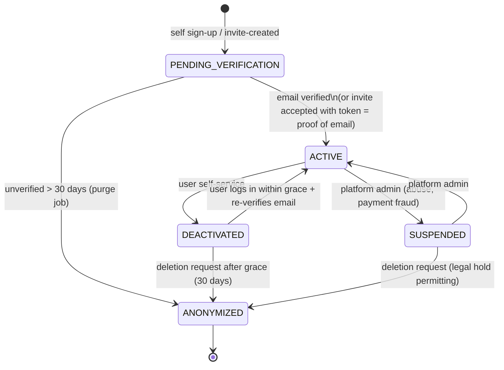
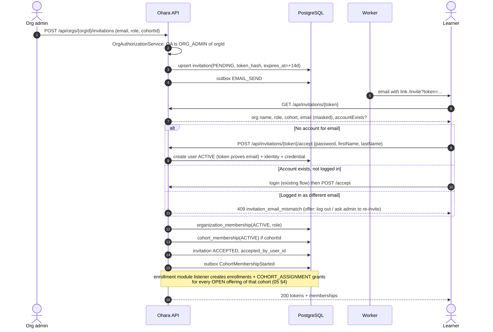

# 04 — Registration, Identity and Account Lifecycle

Status: **Proposed** · 2026-10-21 · Tables referenced are defined in `03-domain-model-and-schema.md` §2–3.

## 1. Account model (Coursera-style separation)

Ohara separates five concepts, following the learner experience popularised by Coursera (one personal account; institution access layered on top; enrollments and progress separate). This is Ohara's own design — it does not reproduce any private Coursera schema.

| Concept | Table(s) | Question it answers |
|---|---|---|
| Identity | `users`, `user_profile` | Who is this person? |
| Authentication | `auth_identity`, `password_credential`, `refresh_token`, `one_time_token` | How do they prove it? |
| Affiliation | `organization_membership`, `cohort_membership` | Which institutions/cohorts are they part of, in which role? |
| Enrollment & entitlement | `enrollment`, `access_grant` | What can they learn, and why, until when? |
| Learning record | `lesson_progress`, `live_attendance` | What have they done? |

**Entities kept / simplified / rejected**

| Candidate | Decision |
|---|---|
| `User`, `UserProfile` | Keep (exist). Profile becomes the only home of names. |
| `UserCredential` | Already modeled as `auth_identity` + `password_credential` — keep; supports later Google/SAML SSO for colleges by adding identities, not users. |
| `Organization`, `OrganizationMembership`, `Cohort`, `CohortMembership`, `Invitation` | New, required. |
| `UserRole` | Keep for **platform** roles only. Org roles live on memberships. A separate permission table is not needed yet — permissions are code-defined per role (10 §2). |
| `UserConsent` | New, minimal (terms/privacy/marketing/AI processing), append-only. |
| `Student` | **Rejected** (see 03 §11). |
| Separate `Instructor` table | **Rejected** — instructor = membership role + `course_instructor`. |

## 2. Account state machine

| State | Can log in | Can access content | Notes |
|---|---|---|---|
| PENDING_VERIFICATION | Yes (limited token, `scope=unverified`) | Free previews only; **no granted or B2B content** until verified | Avoids squatting someone else's email |
| ACTIVE | Yes | Per grants | |
| SUSPENDED | No | No | All refresh tokens revoked; access tokens die within TTL (≤ 15 min after change, see §4) |
| DEACTIVATED | Login → reactivation flow only | No | Memberships/enrollments untouched; grants keep ticking (an expired window stays expired) |
| ANONYMIZED | No | No | PII scrubbed, row retained for history |

Org membership status is independent: an ACTIVE user can be `REMOVED` from College A and still ACTIVE in College B and in B2C.

## 3. Flows

### 3.1 B2C email/password registration
1. `POST /api/auth/register` `{email, password, firstName, lastName, consents[]}`.
2. Normalise email (trim, lower-case; no Gmail dot-folding — that is provider-specific and surprising).
3. If an account exists for `lower(email)`:
   - **ACTIVE / SUSPENDED / DEACTIVATED:** respond **202 with the same body as success** and email the address "someone tried to sign up; log in or reset your password". Prevents account enumeration (today's 400 "User already exists" is changed).
   - **PENDING_VERIFICATION:** re-send verification (rate limited); 202.
4. Else create `users(PENDING_VERIFICATION)`, `user_profile`, `user_role(ROLE_USER)`, `auth_identity(local)`, `password_credential` (BCrypt; cost factor 12, see 10 §3), `user_consent` rows, `one_time_token(EMAIL_VERIFICATION, 24 h)`; enqueue `EMAIL_SEND` job via outbox. Same transaction.
5. Attach pending invitations: if `invitation` rows exist for this email, they are **not** auto-accepted (accepting requires the invite token or a verified email; see 3.5) — but the UI lists them after verification.
6. Response 202 `{status: "VERIFICATION_REQUIRED", email}` with **no tokens and no cookie** — returning a session only for new emails would reveal which emails exist. The verification link signs the user in (it returns a full-scope session). A pending user who logs in with their password gets a limited `scope=unverified` session (`GET /api/users/me` only). *Implemented 2026-10-21 (R1 slice 2); consents and invitation attachment come later.*

### 3.2 Email verification
`POST /api/auth/verify-email {token}` → hash, look up unconsumed `EMAIL_VERIFICATION` token, check expiry → set `consumed_at`, `auth_identity.verified_at`, `users.email_verified_at`, `users.status=ACTIVE` → return fresh token pair (full scope). Unknown token → 400 `verification_token_invalid`; expired/used → 410 `verification_token_expired`. `POST /api/auth/verify-email/resend {email}` → always 202; no new email within a 60 s cooldown (per-email/IP rate limits come with the rate-limit slice). Issuing a token invalidates the user's earlier unused tokens of the same purpose.

### 3.3 Login / logout
Existing implementation retained with changes:
- Lockout: after 5 failed attempts within 15 min → `locked_until = now()+15 min` (exponential to 1 h); response is the same generic 401. Per-IP rate limit at the edge (10 §6).
- Login succeeds for `PENDING_VERIFICATION` with `scope=unverified`; `SUSPENDED` → 403 `account_suspended`; `DEACTIVATED` → 403 `account_deactivated` + reactivation link; `ANONYMIZED` → generic 401.
- Access token claims change to `sub=<userId>`, `email`, `ver=<auth_version>` (see §4), `scope`; roles claim carries **platform** roles only. Org roles are resolved server-side per request from memberships (small, cacheable), so a JWT never becomes stale on role changes.
- Logout unchanged (idempotent, clears cookie). Add `POST /api/auth/logout-all` (revoke all refresh tokens, bump `auth_version`).

### 3.4 Password reset
1. `POST /api/auth/forgot-password {email}` → always 202. If an ACTIVE/DEACTIVATED/PENDING account exists, create `one_time_token(PASSWORD_RESET, 30 min)`, invalidating older unconsumed ones; email link.
2. `POST /api/auth/reset-password {token, newPassword}` → validate token → set new hash, `password_changed_at`, clear lockout, **revoke all refresh tokens**, bump `auth_version`, mark verified if pending (possession of the email proves ownership). Email "your password was changed".

### 3.5 Institution-invited learner (diagram 2)

Edge cases:
| Case | Behaviour |
|---|---|
| Expired invitation | 410 `invitation_expired`; admin can resend (same row, new token, new expiry) |
| Revoked invitation | 410 `invitation_revoked` |
| Already accepted | Idempotent: if accepted by the same user → 200 with current state; other user → 409 |
| Invite email ≠ logged-in email | 409 (no silent cross-linking). Org admin may re-invite the other address |
| Existing account is PENDING_VERIFICATION | Accepting with the token verifies it (token was delivered to that email) |
| Existing account is SUSPENDED | 403; admin notified |
| Same email invited by two orgs | Independent invitations; accepting one doesn't affect the other |

### 3.6 Admin-created / bulk-imported learners
Two modes on `bulk_import_job.mode` (and single-user `POST /api/orgs/{orgId}/members`):
- **INVITE (default, recommended):** each row becomes an invitation (or a direct membership if the email already belongs to a verified user *and* the org has `settings.auto_link_existing_accounts=true` — otherwise still an invitation). No passwords are created by admins.
- **CREATE_ACCOUNTS (opt-in, for colleges that require pre-provisioning):** creates `users(ACTIVE)` without a password credential + membership, then emails a "set your password" `PASSWORD_RESET` token (72 h). Never generates or emails a plaintext password.

Bulk import pipeline (async, `BULK_IMPORT` job):
1. `POST /api/orgs/{orgId}/imports` → presigned S3 PUT for CSV/XLSX (≤ 5 MB, ≤ 5,000 rows) → `POST .../imports/{id}/submit`.
2. **Validate** (worker): parse, normalise emails, per-row errors (`INVALID_EMAIL`, `DUPLICATE_IN_FILE`, `MISSING_NAME`, `EXTERNAL_REF_CONFLICT`), detect existing users (`LINKED_EXISTING`) and existing memberships (`SKIPPED_DUPLICATE`). Status `VALIDATED` with a preview summary. Nothing is written to membership tables yet.
3. Admin confirms → `PROCESSING`: rows processed in chunks of 200, each chunk in its own transaction; each row is idempotent (`UNIQUE` on invitation/membership), so a crash mid-way resumes safely.
4. Terminal `COMPLETED` / `COMPLETED_WITH_ERRORS`; error CSV written to S3 (`error_report_key`), downloadable via short-lived presigned GET.
5. Partial failures never roll back successful rows. Re-uploading the same file is blocked by `file_sha256` uniqueness unless the previous job failed/cancelled.

### 3.7 Existing learner joins a college
Same as 3.5 "account exists": the invitation links the existing `users` row. No new account, no duplicate progress. Their B2C enrollments are unaffected.

### 3.8 College learner buys a B2C course
They pay the contract team offline; the contract team grants the B2C offering to the **same email** (05 §5), so the existing account gets a second enrollment — no new user. If they already have active B2B access to the same course, the grant returns 409 `already_has_access` unless the B2B window ends within 30 days (extension case, Q-14). Reports separate B2B vs B2C by offering channel.

### 3.9 Deactivation / reactivation
- `POST /api/users/me/deactivate {password}` → `DEACTIVATED`, revoke all refresh tokens, bump `auth_version`.
- Reactivation: login with correct password → 403 `account_deactivated` + `reactivation_token` → `POST /api/auth/reactivate` → email confirmation → ACTIVE. Within 30 days; afterwards the account remains deactivated until the user requests deletion or support reactivates.
- Org admins cannot deactivate a *user*; they can only remove the *membership* (`REMOVED`) — the person may have other affiliations.

### 3.10 Deletion / anonymization
> **As built (R6 slice 2, 2026-10-31):**
> - **Request.** `POST /api/users/me/deletion-request {password}` → 202. Re-entering the password is required, so a stolen session can't delete the account. The account becomes DEACTIVATED at once: `auth_version` is bumped, refresh tokens are revoked and sign-in is refused. A confirmation email gives the date.
> - **Scheduling.** `ACCOUNT_ANONYMIZE` runs at +`ohara.account.deletion-grace` (30d).
> - **Cancelling.** A platform admin can cancel through `POST /api/admin/users/{id}/deletion/cancel`; the person can't sign in to do it. The stale job then does nothing.
> - **Legal hold.** `PUT|DELETE /api/admin/users/{id}/legal-hold`, set by the contract team or platform admins. While held, the job defers by 7 days at a time, emails the person once per deferral, and audits each one.
> - **Anonymization, in one transaction:**
>   - auth: refresh tokens, one-time tokens, the password credential and auth identity are deleted;
>   - user: email becomes `deleted+{id}@invalid`, names become "Deleted user", and consent withdrawal is recorded;
>   - organization (via the `AccountEvents.Anonymizing` listener): open cohort placements end, so cohort grants end the normal way; memberships become REMOVED; roll numbers are cleared; invitations to the old address are revoked, with email and names scrubbed; bulk-import row details are scrubbed;
>   - ai: the Q&A log is deleted.
> - **Kept:** grants with bank references, enrollments, progress, attendance and the audit trail.
> - **Differences from the design below:**
>   - bulk-import rows are scrubbed rather than deleted, so import totals stay right;
>   - removing the last org admin is allowed for a deletion, and platform admins appoint a replacement;
>   - the person's email jobs (queued or sent) are deleted during anonymization, and all email jobs are purged 7 days after finishing anyway (03 §10.1).
`POST /api/users/me/deletion-request` → `DEACTIVATED` + scheduled `ACCOUNT_ANONYMIZE` job at +30 days (cancel by reactivating). Anonymization:
- Scrub: email → `deleted+{id}@invalid`, `user_profile` names → "Deleted user", phone/avatar null, revoke tokens, delete credentials and `one_time_token`s, withdraw consents, delete pending invitations to that email.
- Keep: `users` row (status ANONYMIZED), access grants with their contract/bank references (finance reconciliation), enrollments/progress/attendance (aggregate reporting; tied to the anonymised id), audit events (with actor id only).
- AI Q&A logs (if stored) and bulk-import rows containing the email are deleted.
- **Legal hold:** if the contract team flags an unresolved payment/refund dispute, deletion is deferred and the user informed.

### 3.11 Email change
`POST /api/users/me/email {newEmail, password}` → if `newEmail` belongs to another account → 202 (generic) and notify that account; else `one_time_token(EMAIL_CHANGE, target_email)` to the new address + notice to the old one. On confirm: update `users.email` and `auth_identity.identifier` atomically, bump `auth_version`. Because JWT `sub` becomes the UUID (V3 change), nothing else breaks.

### 3.12 Duplicate-account resolution (merge)
Not self-service. Platform support tool: choose survivor & duplicate (both verified by the requester) → move memberships, enrollments (resolving `UNIQUE(user_id, offering)` conflicts by keeping the more progressed one), orders, progress by `lesson_key` → anonymize the duplicate → audit `ACCOUNT_MERGED`. Run as a job with a dry-run report first. Rare at this scale; documented so data isn't hand-edited.

## 4. Token freshness and revocation

- Access token TTL reduced from 1 h to **15 min** (property change) once paid content exists.
- `users.auth_version INT` (add in V3): incremented on password reset, logout-all, suspension, deactivation, email change. Access tokens carry `ver`; `JwtAuthenticationFilter` compares it — and `status = ACTIVE` — against the user row on every request (primary-key lookup, implemented 2026-10-21). Revocation is therefore immediate. If profiling shows the lookup matters, add a ≤ 60 s in-process cache (accepting that lag). Refresh-token reuse detection also bumps `auth_version`.
- Org-role changes don't need token revocation because org roles aren't in the token.

## 5. Role matrix (summary — full permission matrix in 10 §2)

| Capability | Platform admin | Org admin | Instructor | Learner |
|---|---|---|---|---|
| Create/suspend organizations | ✔ | | | |
| Manage org members, cohorts, invitations, imports | ✔ (support) | ✔ own org | | |
| Assign courses to cohorts / create offerings | ✔ | ✔ own org (for courses licensed to the org) | | |
| Author courses, upload assets | ✔ platform catalog | ✔ org-private courses | ✔ courses where `course_instructor` | |
| Publish course version | ✔ | ✔ org-private | ✔ if `course_instructor.role=OWNER` | |
| Schedule / host live sessions | | ✔ | ✔ own offerings | |
| View org reports (enrollment, progress, attendance) | ✔ | ✔ own org | ✔ own cohorts/courses | own only |
| Approve AI artifacts | ✔ | ✔ | ✔ own courses | |
| Grant/revoke B2C access after offline payment | ✔ | | | |
| Learn, view own progress | ✔ | ✔ | ✔ | ✔ |

The contract team uses the platform role `ROLE_ENROLLMENT_MANAGER` (grant/extend/revoke B2C access, reconciliation report — nothing else).

## 6. API surface (details in 08 §2–3)

Auth: `register`, `verify-email`, `verify-email/resend`, `login`, `refresh`, `logout`, `logout-all`, `forgot-password`, `reset-password`, `reactivate`. Users: `GET/PATCH /api/users/me`, `POST /api/users/me/email`, `POST /api/users/me/password`, `POST /api/users/me/deactivate`, `POST /api/users/me/deletion-request`, `GET /api/users/me/organizations`. Invitations: `GET /api/invitations/{token}`, `POST /api/invitations/{token}/accept`.

## 7. Implementation notes against current code

- `AuthService.register`: replace `IllegalArgumentException("User already exists")` with the enumeration-safe branch; set `PENDING_VERIFICATION`; write consents and verification token; move name to profile only.
- `AppUserDetailsService`: map statuses (PENDING_VERIFICATION is *enabled*; scope is decided after authentication).
- `JwtTokenProvider`: `subject(user.getId().toString())`, add `email`, `ver`, `scope`; `getAuthentication` builds a principal `CurrentActor(userId, email, platformRoles)`.
- `UserController.me` resolves by id from the principal, not by email.
- Keep refresh-cookie mechanics as implemented (`AuthController`) — they already meet the standard.
