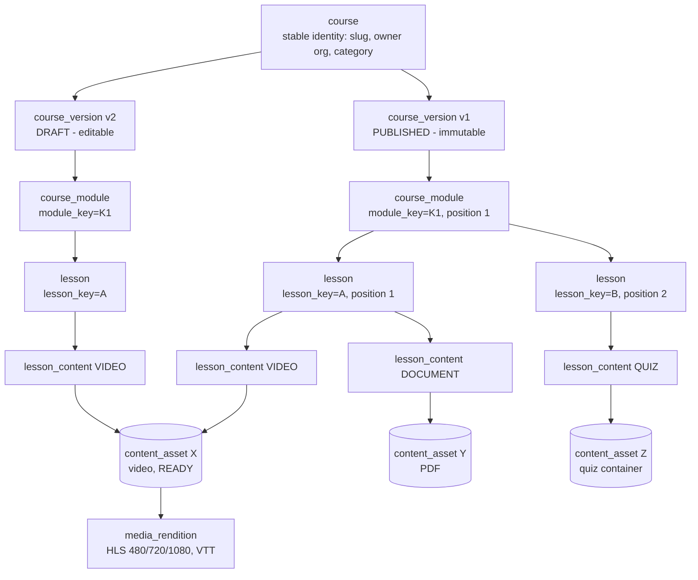

# 05 — Courses, Curriculum, Enrollment and Entitlements

Status: **Proposed** · 2026-10-21 · Tables: `03-domain-model-and-schema.md` §4–7.

## 1. Curriculum hierarchy (diagram 5)



Both versions point at the **same** `content_asset X`: publishing v2 copies curriculum rows, never files.

## 2. Lifecycle states

| Entity | States | Rules |
|---|---|---|
| `course` | DRAFT → ACTIVE → RETIRED | ACTIVE once any version is published. RETIRED hides from catalog; existing enrollments continue until their grants end. |
| `course_version` | DRAFT → PUBLISHED → ARCHIVED | One DRAFT at a time. PUBLISHED is immutable (service + trigger). Publishing v(n+1) does not archive v(n) while enrollments are pinned to it; a job archives versions with zero active enrollments. |
| `course_module`, `lesson`, `lesson_content` | inherit the version's state | Editable only in a DRAFT version. |
| `content_asset` | see 03 §5.4; plus RETIRED | Retiring an asset referenced by a PUBLISHED version requires a replacement (`replaced_by_asset_id`) or a new version. |
| `course_offering` | DRAFT → OPEN → CLOSED → ARCHIVED | OPEN: new enrollments allowed. CLOSED: no new enrollments, existing access continues per grants. |

### Publication checklist (`POST /api/courses/{id}/versions/{v}/publish`)
- Every `lesson_content` of kind VIDEO/DOCUMENT references an asset in `READY`.
- Every module has ≥ 1 lesson; positions contiguous.
- Required metadata (title, description, language, thumbnail).
- Caller is course OWNER / org admin of owner org / platform admin.
- Sets `published_at`, `course.current_published_version_id`, emits `CourseVersionPublished`.
- AI artifacts are **not** a publish prerequisite.

## 3. Versioning policy

**Choice: copy-on-write snapshot per version**, with stable `module_key`/`lesson_key` identities. Rejected alternatives: (a) editing live curriculum in place (learners see half-finished edits; progress corrupts), (b) event-sourced curriculum (overkill for a few hundred lessons).

| Scenario | Handling |
|---|---|
| Fix a typo in a published lesson title | Create draft (copies rows), edit, publish v(n+1). Optional "minor publish" flag auto-migrates active enrollments (only allowed when the diff contains no structural change — titles, descriptions, asset replacements with same `lesson_key`). |
| Reorder lessons | In draft: update `position` values in one transaction (deferrable unique constraint). |
| Replace a video | Upload new asset; in draft, point the `lesson_content` at the new asset; publish. Old asset stays for v(n) learners. |
| Retire a video everywhere (e.g. legal takedown) | Platform/org admin action `RETIRE_ASSET`: marks asset RETIRED; playback denied immediately (ContentAccessService checks asset status); curriculum shows "content unavailable"; owners notified to publish a fixed version. |
| Delete a lesson | Only in draft; deletes lesson + its `lesson_content`; assets untouched. |
| Delete an asset | Allowed only if no `lesson_content` references it (RESTRICT FK) and it isn't a live recording linked to a session; otherwise RETIRE. |
| Existing learners when v(n+1) publishes | Stay pinned to v(n) (`enrollment.course_version_id`). Shown "A newer version is available" — opt-in switch, or org admin bulk-migrates a cohort. |
| New learners | `LATEST_ON_ENROLL` offerings → current published version; `PINNED` offerings (colleges locking syllabus for a semester) → the pinned version. |
| Migrating an enrollment | Set `course_version_id`; progress is keyed by `lesson_key`, so completed lessons that still exist stay completed; removed lessons drop out of the denominator; new lessons appear not started. `progress_percent` recomputed. Audit `ENROLLMENT_VERSION_MIGRATED`. |

## 4. B2B: institution course assignment (diagram 3)

```mermaid
sequenceDiagram
  autonumber
  actor OA as Org admin
  participant API as Ohara API
  participant ENR as enrollment module
  participant DB as PostgreSQL
  OA->>API: POST /api/orgs/{orgId}/offerings {courseId, cohortId, startsAt, endsAt, versionPolicy}
  API->>API: OrgAuthorizationService: ORG_ADMIN of orgId;<br/>course is platform catalog licensed to org OR owned by org
  API->>DB: course_offering(B2B, DRAFT)
  OA->>API: POST /api/offerings/{id}/open
  API->>DB: status OPEN
  API->>ENR: event OfferingOpened (outbox)
  ENR->>DB: for each ACTIVE cohort_membership of cohort:<br/>INSERT enrollment ON CONFLICT (user_id, offering) DO NOTHING<br/>INSERT access_grant(COHORT_ASSIGNMENT, source_ref=cohort_membership.id,<br/>valid_from=startsAt, valid_until=endsAt) ON CONFLICT DO NOTHING
  Note over ENR,DB: chunks of 500 per transaction; idempotent — re-running is safe
  Note over ENR: Later joins: CohortMembershipStarted → same insert for every OPEN offering of the cohort
```

**Course licensing to an org** (which platform courses an org may assign) is a commercial fact. Minimal model: `organization.settings.licensed_course_ids` for v1; promote to an `organization_course_license(org_id, course_id, starts_on, ends_on, seat_limit)` table when contracts need seat counts or dates (Q-03).

| B2B event | Effect |
|---|---|
| Learner removed from cohort | `cohort_membership.left_at=now`, status REMOVED → listener sets `revoked_at` on grants with `source_ref_id = that membership` → enrollment status `REVOKED` if no other active grant. Progress kept. |
| Transfer A → B | Close membership A (TRANSFERRED, `transferred_to_cohort_id`), open B. Grants from A revoked; grants for B's offerings created. If the same course is offered to both cohorts, the learner gets a new enrollment (different offering) and progress is **copied by `lesson_key`** from the old enrollment (configurable: copy vs fresh start). |
| Offering window changes (extension) | Update `ends_at` → listener updates `valid_until` on its COHORT_ASSIGNMENT grants not yet revoked. |
| Offering ends | No action needed: grants expire by `valid_until`. Nightly job sets enrollment status `EXPIRED` for reporting. |
| Org suspended | `ContentAccessService` checks org status → all B2B access for that org denied immediately; data retained. |
| Completion | When all required lessons are COMPLETED → `enrollment.status=COMPLETED`, `completed_at`; grants unaffected (learner can review until window end). |
| Historical reporting | Reports query `enrollment` + `lesson_progress` + `live_attendance` by `course_offering_id`/`organization_id`, regardless of grant state. |

Per-institution pricing/duration differences live on the offering (window) and the license (contract), never in course content.

## 5. B2C: purchase and entitlement (diagram 4)

```mermaid
sequenceDiagram
  autonumber
  actor U as Learner
  participant API as Ohara API
  participant DB as PostgreSQL
  participant PG as Payment gateway
  participant ENR as enrollment module
  U->>API: POST /api/checkout {offeringId} + Idempotency-Key
  API->>API: user ACTIVE & email verified; offering B2C OPEN; no active FULL grant
  API->>DB: purchase_order(CREATED) + order_item(PENDING)<br/>UNIQUE(user, offering) WHERE PENDING blocks concurrent duplicates
  API->>PG: create gateway order (amount, receipt=order.id)
  API->>DB: gateway_order_id, status PAYMENT_PENDING
  API-->>U: {orderId, gateway, gatewayOrderId, key} for checkout widget
  U->>PG: pays in gateway UI
  PG-->>U: client callback (NOT trusted for access)
  U->>API: POST /api/checkout/{orderId}/confirm {gatewayPaymentId, signature}
  API->>API: verify signature server-side; fetch payment status from gateway
  PG->>API: webhook payment.captured (signed)
  API->>DB: payment_webhook_event (UNIQUE gateway_event_id) — 200 ack fast
  Note over API,DB: confirm-call and webhook converge on the same idempotent handler
  API->>DB: payment_transaction CAPTURED (UNIQUE gateway_payment_id) ;<br/>order PAID ; order_item FULFILLED — one transaction
  API->>ENR: event PaymentCaptured(orderItemId) via outbox
  ENR->>DB: enrollment ON CONFLICT DO NOTHING ;<br/>access_grant(PURCHASE, source_ref=order_item.id) ON CONFLICT DO NOTHING
  U->>API: GET /api/checkout/{orderId} → PAID + enrollmentId
```

| Situation | Handling |
|---|---|
| Duplicate checkout click | Same `Idempotency-Key` → same order returned (`idempotency_key` table / `UNIQUE(user_id, idempotency_key)`). |
| Two tabs, different keys | Second insert of `order_item` PENDING for same (user, offering) hits partial unique → 409 returning the existing pending order. |
| Payment failed | Webhook `payment.failed` → `payment_transaction FAILED`; order stays `PAYMENT_PENDING` until gateway order expiry (user can retry within it), then `FAILED`; `order_item CANCELLED`. |
| Client says success, no webhook yet | `/confirm` verifies signature **and** queries gateway; access granted only if gateway says captured. |
| Webhook retries / out of order | `UNIQUE(gateway, gateway_event_id)` dedups; state transitions only move forward (`PAID` never reverts to `PAYMENT_PENDING`). |
| Webhook never arrives | Reconciliation job every 10 min queries gateway for orders `PAYMENT_PENDING` older than 5 min. |
| Paid twice (rare double capture) | Second capture recorded; grant creation is a no-op (unique `source_ref`); auto-refund job for the duplicate payment + alert. |
| Refund | Admin/automated `POST /api/admin/orders/{id}/refunds` → gateway refund → webhook `refund.processed` → `payment_transaction REFUND`, order REFUNDED → grant `revoked_at`, reason `REFUNDED`; enrollment `CANCELLED`; progress kept. |
| Access expiry | `access_duration_days` on the offering → `valid_until = paid_at + duration`. |
| Price change | Order stores `unit_price_minor` at purchase; offering price changes don't affect existing orders. |

Subscriptions: if ₹1,000/month turns out to be a subscription (Q-01), a `subscription` record issues one `access_grant(SUBSCRIPTION)` per catalog enrollment whose `valid_until` is extended on each successful renewal webhook; cancellation sets `valid_until = current_period_end`. The rest of the model is unchanged — that's the point of separating grants from payments.

## 6. Central authorization: `ContentAccessService`

Single entry point in the `enrollment` module's named interface:

```java
AccessDecision check(CurrentActor actor, ResourceRef resource, Action action);
// ResourceRef: COURSE | COURSE_VERSION | LESSON | LESSON_CONTENT | ASSET | LIVE_SESSION | AI_ARTIFACT
// Action: VIEW_METADATA | VIEW_CONTENT | PLAY | DOWNLOAD | ATTEMPT_QUIZ | JOIN_LIVE | QUERY_AI
// AccessDecision: ALLOW(enrollmentId, validUntil, scope) | DENY(reason)
```

Evaluation order (first failure wins; every DENY is logged with reason, cross-tenant DENYs are audited):

1. **Actor status** — `users.status = ACTIVE` (PENDING_VERIFICATION → only `is_preview` lessons and metadata). `auth_version` matched (filter).
2. **Staff bypass** — platform admin; org admin / instructor of the **owning** org or a `course_instructor` → ALLOW (authoring/preview), recorded with `scope=STAFF`.
3. **Resolve the resource to `(course_id, course_version_id, lesson_key?, asset_id?, organization scope)`** via a single query.
4. **Resource state** — course not RETIRED for new access; asset `READY` and not RETIRED for PLAY/DOWNLOAD; live session not CANCELLED.
5. **Preview shortcut** — lesson `is_preview = true` and action ∈ {VIEW_CONTENT, PLAY} → ALLOW (scope PREVIEW), no enrollment needed.
6. **Enrollment** — find the actor's enrollments for `course_id` with status ∈ {ACTIVE, COMPLETED}. None → DENY `not_enrolled`.
7. **Version membership** — the requested lesson/asset must belong to the enrollment's pinned `course_version_id` (prevents fetching a lesson of a version you aren't on — important for org-private drafts).
8. **Grant** — exists `access_grant` for that enrollment with `revoked_at IS NULL AND valid_from <= now() AND (valid_until IS NULL OR valid_until > now())` and scope sufficient.
9. **Tenant context** — for B2B enrollments: offering's org ACTIVE, actor's `organization_membership` ACTIVE, and (for cohort offerings) the cohort membership that sourced the grant not ended (already reflected in grant revocation; double-checked here because it's cheap).
10. **Action-specific rules** — DOWNLOAD only if `lesson_content.settings.downloadable`; JOIN_LIVE only within `[scheduled_start − 15 min, scheduled_end + 30 min]` and offering/cohort matches; QUERY_AI only if org setting `ai_qa_enabled`.

Returns `validUntil = min(grant.valid_until, offering.ends_at)` so callers can cap token/cookie TTLs.

**Reuse:**
| Caller | Resource / action |
|---|---|
| Course page & curriculum | COURSE / VIEW_METADATA (any), LESSON / VIEW_CONTENT (lock icons) — batched variant `checkMany` for one course |
| Playback authorization | ASSET / PLAY → signed cookies (06 §6) |
| PDF/download | LESSON_CONTENT / DOWNLOAD → 60 s presigned GET or signed URL |
| Quiz attempt | LESSON_CONTENT / ATTEMPT_QUIZ |
| Live join | LIVE_SESSION / JOIN_LIVE → IVS playback + chat tokens |
| Transcript, captions, AI artifacts | AI_ARTIFACT / VIEW_CONTENT (resolves to its asset) |
| Grounded Q&A | QUERY_AI; retrieval restricted to assets for which `check(PLAY)` would ALLOW |

**Performance:** one indexed query per decision (enrollment + grant + offering join on `(user_id, course_id)`); per-request memoization; optional 60 s cache keyed by `(userId, courseId)` invalidated by `AccessChanged` events. A playback session costs one decision per cookie refresh, not per segment.

## 7. Progress and completion

- Heartbeat `PUT /api/enrollments/{id}/lessons/{lessonKey}/progress {positionMs, durationMs, watchedDeltaMs, clientTs}` every 20 s and on pause/seek/exit. Server clamps `watchedDeltaMs ≤ wall-clock since last heartbeat + 5 s` to blunt fake completion.
- Video lesson COMPLETED when `watched_ms ≥ 90%` of duration (configurable per offering); reading lessons when the learner marks done; quiz lessons on passing attempt (assessment module).
- Resume: `GET /api/me/continue-watching` (by `updated_at`), and per-lesson `video_position_ms` returned with the playback authorization.
- `enrollment.progress_percent` recomputed asynchronously (debounced job) — never on the heartbeat's hot path.
- Progress belongs to the enrollment; it is never deleted when access ends.

## 8. Access-control rules (summary)

1. Membership ≠ access. Only grants open content.
2. Enrollment ≠ permanent access. Grants have windows; revocation is explicit.
3. Payment ≠ access until the server verifies capture.
4. A learner never sees another version's curriculum than the one pinned (except staff).
5. All checks happen server-side in `ContentAccessService`; the UI's lock icons are a convenience copy of the same decisions.
