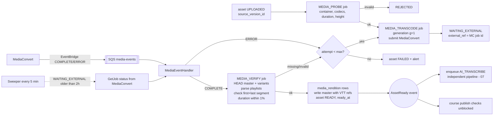
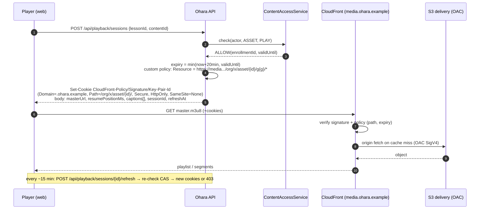
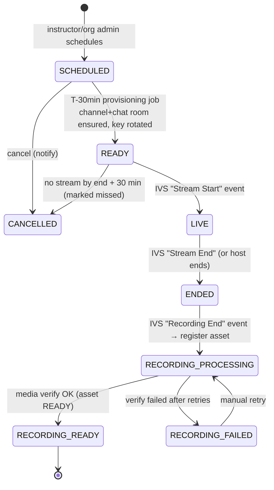

# 06 — Prerecorded Video and Live Streaming

Status: **Proposed** · 2026-10-21 · AWS integrations are **proposed additions** (none exist in the repo). Each is implemented behind a port with a mock adapter first.

## 1. Ports

| Port | Real adapter | Mock adapter (local) |
|---|---|---|
| `ObjectStorage` (presign PUT/GET, multipart, head, copy, list) | AWS SDK v2 S3 | Local filesystem under `./var/storage` + an in-app "S3-like" upload endpoint (dev only) |
| `Transcoder` (submit, status) | MediaConvert | Copies the source as a single-rendition "HLS" stub, emits a completion event after N seconds; configurable failure injection |
| `CdnSigner` (signed cookies/URLs) | CloudFront key group (RSA/ECDSA private key in Secrets Manager) | Issues HMAC cookie checked by a dev servlet filter |
| `MediaEventSource` | SQS long-polling (`media-events` queue) | In-memory queue |
| `LiveStreamingProvider` (create channel, stream key, playback token, chat token, end) | Amazon IVS + IVS Chat | Fake channel returning a sample HLS URL |

## 2. Direct-to-S3 upload flow (diagram 6)

*Built 2026-10-31 (R3 slice 1) against the `ObjectStorage` port with `LocalObjectStorage` (disk + HMAC-signed `/dev-storage/**` URLs standing in for S3 presigned URLs, active when `ohara.storage.provider=local`, the default). Endpoints: `POST /api/assets` (Idempotency-Key), `POST /api/uploads/{id}/parts`, `GET /api/uploads/{id}`, `POST /api/uploads/{id}/complete|abort`; library `GET /api/assets`, `GET/PATCH/DELETE /api/assets/{id}`, `POST …/retire`. Documents/images get a magic-number check and are READY at completion; videos enqueue `MEDIA_PROCESS`. Abandoned uploads are expired by a scheduled sweeper on worker instances. The S3 adapter and the ObjectCreated safety net arrive with the AWS account (Q-04).*

```mermaid
sequenceDiagram
  autonumber
  actor I as Instructor
  participant API as Ohara API
  participant DB as PostgreSQL
  participant S3 as S3 ohara-media-source
  participant Q as SQS media-events
  participant W as Worker
  I->>API: POST /api/assets {type: VIDEO, title, fileName, bytes, mime, sha256?} + Idempotency-Key
  API->>API: authorize (instructor/org admin of owner org); validate size, mime, extension
  API->>DB: content_asset(PENDING_UPLOAD) + media_upload(INITIATED)
  API->>S3: CreateMultipartUpload(key, checksum algo SHA256, SSE)
  API-->>I: {assetId, uploadId, partSize, expiresAt}
  loop each batch of parts
    I->>API: POST /api/uploads/{uploadId}/parts:presign {partNumbers[1..N]}
    API-->>I: presigned UploadPart URLs (15 min)
    I->>S3: PUT part (Content-MD5 / x-amz-checksum-sha256)
  end
  I->>API: POST /api/uploads/{uploadId}/complete {parts[{n, etag, checksum}]}
  API->>S3: CompleteMultipartUpload
  API->>S3: HeadObject → size, versionId, checksum
  API->>DB: media_upload COMPLETED; asset UPLOADED (source_version_id, bytes)<br/>+ processing_job MEDIA_PROBE (idempotency key = asset:versionId)
  S3-->>Q: ObjectCreated event (safety net)
  W->>Q: poll → ensure the same MEDIA_PROBE job exists (UNIQUE idempotency_key)
  W->>DB: claim MEDIA_PROBE → probe (MediaConvert/ffprobe-lite) → PROCESSING + MEDIA_TRANSCODE
```

### Rules
- **Limits:** video ≤ 20 GB and ≤ 4 h (configurable per org); documents ≤ 100 MB; images ≤ 10 MB.
- **Allowed video:** `video/mp4`, `video/quicktime`, `video/x-matroska`, `video/webm` (extensions `.mp4 .mov .mkv .webm`). Documents: PDF only initially. The declared MIME is untrusted: the probe step verifies container/codec; mismatch → `REJECTED`.
- **Multipart:** part size 16–64 MB (client chooses by file size; ≤ 10,000 parts), parallel 4–6 parts, resumable (client keeps `uploadId`; `GET /api/uploads/{id}` lists uploaded parts via `ListParts`). Single PUT allowed ≤ 100 MB.
- **Presigned URL expiry:** 15 min per part URL; upload session `expires_at` 24 h.
- **Checksums:** per-part SHA-256 checksums (S3 additional checksums) + optional full-file SHA-256 provided by client; the asset stores `source_sha256` when supplied. Duplicate-upload detection: same org + same sha256 + READY asset → API offers reuse.
- **Idempotency:** `Idempotency-Key` on initiate (`UNIQUE(initiated_by, client_idempotency_key)`); `complete` is idempotent (repeat returns current asset state).
- **Security:** bucket private, Block Public Access on, SSE-S3 (or SSE-KMS if compliance asks), presigned URLs bound to exact key + content-length range (`Content-Length` signed) + checksum; keys generated server-side (never client file names). Malware: documents (PDF) scanned asynchronously (e.g. GuardDuty Malware Protection for S3 — proposed; verify availability/cost) before `READY`; videos are only ever served as transcoded output, never the original bytes, which removes most risk.
- **Abandoned uploads:** S3 lifecycle rule `AbortIncompleteMultipartUpload` after 2 days; sweeper job marks `media_upload EXPIRED` and asset `CANCELLED` when `expires_at` passes.
- **Missed completion call** (browser closed after last part): if the client never calls `complete`, S3 has no object yet (multipart not completed) → the upload simply expires. If `complete` succeeded at S3 but the API crashed before updating the DB, the `ObjectCreated` SQS event triggers `MediaEventHandler`, which looks up `media_upload` by `object_key` and finishes the transition idempotently.
- **Ownership/audit:** `media_upload.initiated_by`, `content_asset.created_by`, `audit_event ASSET_UPLOADED`.

## 3. Storage layout

> **As built (AWS adapters, S3, 2026-10-31):**
> - **Selecting it.** `S3ObjectStorage` (AWS SDK v2 2.57.8, URL-connection HTTP client) is selected with `ohara.storage.provider=s3`.
> - **Configuration:**
>   - `ohara.aws.region`, default ap-south-1;
>   - `ohara.storage.s3.source-bucket` and `ohara.storage.s3.delivery-bucket`;
>   - credentials from the default AWS chain (task/instance role);
>   - `ohara.storage.s3.endpoint`, `path-style` and static keys exist only for emulators and must not be set in production.
> - **Bucket routing.** Keys under `delivery/` go to the delivery bucket (the CloudFront origin); everything else, uploads and `live/` recordings, goes to the versioned source bucket.
> - **Upload protocol.** Part URLs are presigned for the part's exact `Content-Length`, so an oversized or tampered request is refused by S3. Completion maps `InvalidPart`/`InvalidPartOrder`/`EntityTooSmall`/`NoSuchUpload` to the same mismatch error as the local adapter.
> - **Checksums.** The returned version id identifies the bytes. There's no whole-file SHA-256, because S3 multipart checksums are per part, so a client-declared checksum isn't compared for S3 uploads. (Option for later: CRC64 full-object checksums.)
> - **Downloads** carry RFC 6266 `Content-Disposition` with the original UTF-8 file name.
> - **Recordings.** Adoption uses server-side `CopyObject` from the source bucket to the delivery bucket.
> - **Tests.** Against LocalStack 4.9 S3 with signature validation on (Testcontainers; skipped without Docker).
> - **Still to do:** the bucket IaC (versioning, lifecycle and BPA as below), MediaConvert, CloudFront, IVS and the SQS event intake.

**Two buckets** (different access patterns, policies and lifecycle), both in `ap-south-1`:

| Bucket | Contents | Access | Versioning | Lifecycle |
|---|---|---|---|---|
| `ohara-media-source-{env}` | Original uploads, live recordings (IVS), bulk-import files | API/worker IAM roles only; MediaConvert role read | **On** (immutable inputs, retry without re-upload) | Originals: Standard → Glacier Instant Retrieval after 30 days (still retrievable in ms for reprocessing). Imports: delete after 90 days. Noncurrent versions: delete after 30 days. |
| `ohara-media-delivery-{env}` | HLS renditions, thumbnails, captions/VTT, AI exports (large), downloadable PDFs | CloudFront OAC only; worker writes | Off (paths are versioned by generation) | Superseded generations deleted 7 days after a new generation is READY. Intelligent-Tiering for renditions older than 90 days (long-tail courses). |

Key scheme (no PII, no file names):
```
source:   org/{orgId|platform}/asset/{assetId}/source/{uploadId}.{ext}
          live/{sessionId}/ivs/...                       (IVS recording prefix)
          imports/{orgId}/{jobId}.csv
delivery: org/{orgId|platform}/asset/{assetId}/g{generation}/hls/master.m3u8
          org/{orgId|platform}/asset/{assetId}/g{generation}/hls/{720p}/seg_00001.ts|.m4s
          org/{orgId|platform}/asset/{assetId}/g{generation}/thumbs/{n}.jpg
          org/{orgId|platform}/asset/{assetId}/captions/{lang}/v{transcriptVersion}.vtt
          org/{orgId|platform}/asset/{assetId}/docs/{file}.pdf
```
The `asset/{assetId}/` prefix is the unit of authorization for signed cookies (§6). Public S3 URLs are never used.

## 4. Transcoding: MediaConvert vs FFmpeg workers

> **As built (AWS adapters, MediaConvert, 2026-10-31):**
> - **Selecting it.** `MediaConvertTranscoder` is selected with `ohara.media.transcoder=mediaconvert`.
> - **Configuration:** `ohara.media.mediaconvert.role-arn` (the role MediaConvert assumes to read the source bucket and write the delivery bucket), plus optional `queue-arn` and `qvbr-quality` (default 7).
> - **Probe.** Uses MediaConvert's Probe API: duration, and video size with rotation applied. Audio-only or unreadable files are rejected; throttling and 5xx errors are retried by the job.
> - **Job.** One HLS group at `<delivery prefix>master`: 6 s segments, one output per ladder rung (`master_<height>p.m3u8`), H.264 Main QVBR capped at the rung's max bitrate, 2 s GOP with scene-change detection, AAC stereo at the rung's audio bitrate. Only the height is set, so 4:3 sources keep their shape.
> - **Status.** ERROR and CANCELED map to FAILED with MediaConvert's error code; the pipeline's retries and HLS verification are unchanged.
> - **Port contract.** The `Transcoder` contract is now "a master listing variants by relative URI" rather than a fixed file layout. A test shows the verifier accepts MediaConvert's single-directory layout.
> - **Tests.** Request shape and state mapping are checked with a mocked client. There's no emulator, so a dev-account smoke test with the 3 sample lectures remains (R3 testing).

| Criterion | MediaConvert (recommended) | FFmpeg on EC2/Fargate workers |
|---|---|---|
| Direct cost at 100 h/month (07/11) | ~$225/month Basic tier (1080p source → 1080/720/480), ~$360 Professional | ~$30–60/month compute (spot) |
| Engineering/ops | Job template + IAM; no fleet | Build images, ladder tuning, autoscaling, spot interruption handling, codec CVEs, monitoring |
| Throughput / burst | Parallel, scales instantly | Bounded by fleet; backlog during bursts |
| Quality features | QVBR, accelerated transcoding, captions (Pro tier) | Anything, with effort |
| Lock-in | Medium (port + JSON templates) | None |

**Decision:** MediaConvert Basic tier for v1 (ADR-007). The ~$170–190/month difference doesn't pay for the ops burden at 100 h/month. Re-evaluate if monthly normalized minutes exceed ~1M or if a feature (e.g. burned-in watermark per user) requires custom processing. Captions are delivered as **sidecar WebVTT** referenced from the master playlist written by the worker, so the Basic tier's caption exclusion doesn't block us (verify player support on iOS Safari).

### ABR ladder (lecture-tuned)

Lecture video is mostly static slides/whiteboard + a talking head: it compresses far better than film. Use H.264 (AVC) for universal playback, QVBR (Pro) or capped VBR (Basic), 6 s segments, 2 s GOP aligned across renditions, AAC 96 kbps stereo (64 kbps for 480p), fMP4/CMAF segments.

| Rendition | Resolution | Target / max video bitrate | Produced when |
|---|---|---|---|
| 1080p | 1920×1080 | 2.5 / 4.0 Mbps | source height ≥ 1080 **and** `content_profile=SCREEN_DETAIL` (code, small fonts) or org opts in |
| 720p | 1280×720 | 1.2 / 2.0 Mbps | source height ≥ 720 |
| 480p | 854×480 | 0.6 / 0.9 Mbps | always (or source height if lower) |
| 360p (optional) | 640×360 | 0.35 / 0.5 Mbps | mobile-data heavy audiences (Q-10) |
| Audio-only | — | 64 kbps | optional, low-bandwidth mode |

- Never upscale: ladder rungs above source height are skipped.
- Thumbnails: every 10 s (scrubbing preview) + poster.
- `content_profile` (`TALKING_HEAD`, `SLIDES`, `SCREEN_DETAIL`) set by the uploader; default `SLIDES` → 720p top rung. This is the biggest delivery-cost lever (11 §6).

### Pipeline (diagram 7)

*Built 2026-10-31 (R3 slice 2): `MEDIA_PROCESS` (probe → ladder → submit) and `MEDIA_CHECK` (poll every `ohara.media.poll-interval`, max 240 polls) jobs over the `Transcoder` port; `LocalTranscoder` writes real HLS playlists + placeholder segments; `HlsVerifier` checks master, every variant (ENDLIST, first/last segment, duration ±2 %) before READY; failed/invalid output retried up to 3 times, then FAILED with source kept; `POST /api/assets/{id}/reprocess` for FAILED videos; delivery path `delivery/org/{org}/asset/{id}/g{generation}/hls/`. Thumbnails, captions and the MediaConvert adapter (with EventBridge→SQS completion events instead of polling) are pending.*



`READY` is set only by `MEDIA_VERIFY` (ADR-007 consequence). A transcode that "succeeded" but produced an unplayable manifest stays non-ready and retries.

## 5. HLS playback behaviour

- **Master playlist** lists variants with `BANDWIDTH`, `RESOLUTION`, `CODECS`, plus `#EXT-X-MEDIA TYPE=SUBTITLES` entries for VTT tracks. **Media playlists** list 6 s segments (`#EXT-X-TARGETDURATION:6`).
- **Player** (hls.js on web, AVPlayer on iOS, ExoPlayer on Android) picks the rendition by measured bandwidth and buffer health; start at 480p for fast first frame, switch up within seconds. Policy cap: data-saver mode limits to 480p.
- **Seeking:** segment-aligned; thumbnails sprite for preview; resume from `lesson_progress.video_position_ms` (returned with playback authorization).
- **CDN caching:** segments are immutable (`Cache-Control: public, max-age=31536000, immutable` set on upload by the worker) — the generation number in the path makes them safe to cache forever. Master/media playlists `max-age=300`. Cache key ignores cookies/query strings (signed-cookie auth is evaluated before cache lookup). Origin Shield in `ap-south-1` to reduce S3 GETs.
- **Captions:** VTT files served through the same signed path; language list from `lecture_artifact` approved captions.
- **Errors/recovery:** player retries segment 3× with backoff, then drops a rendition; on 403 (cookie expired) the player calls `POST /api/playback/sessions/{id}/refresh` and retries; after fatal errors it reports `POST /api/playback/errors` (sampled) for observability.

## 6. Playback authorization (diagram 9)

> **As built (AWS adapters, CloudFront, 2026-10-31):**
> - **Selecting it.** `CloudFrontCdnSigner` is selected with `ohara.cdn.provider=cloudfront`.
> - **Configuration:**
>   - `ohara.cdn.cloudfront.domain` (the media host);
>   - `key-pair-id` (the public key's id in the distribution's trusted key group);
>   - the signing key as a PKCS#8 PEM from `private-key-path` (a file mounted from Secrets Manager) or `private-key`. It's loaded at startup; PKCS#1 is rejected with the conversion command.
>   - `ohara.cdn.cookie-domain` (e.g. `.example.in`, shared by the API and media hosts).
> - **Cookies.** Each grant is a custom policy for `https://<media>/<video prefix>*` until the session expiry, with SHA1withRSA, CloudFront's default. Cookies are Secure, HttpOnly and SameSite=Lax, with Path set to the video prefix, so several videos' cookies coexist. Tests verify the policy and signature with the public key exactly as CloudFront does.
> - **Still to do with the account:**
>   - the distribution: OAC to the delivery bucket, the key group, and a CORS response-headers policy allowing the app origin with credentials for hls.js `withCredentials`;
>   - confirming cookie behaviour on iOS/Android players (Q-11).

*Built 2026-10-31 (R3 slice 3, `media` module): `POST /api/playback/sessions {lessonId, contentId}` runs the learner lesson check (ContentAccessService), requires a READY video, records a `playback_session`, and sets signed cookies scoped to the asset's generation prefix via the `CdnSigner` port; expiry = min(20 min, end of the learner's access); `POST …/{id}/refresh` re-checks access. `LocalCdn` + `/dev-cdn/**` stand in for CloudFront (policy = HMAC(prefix, expiry)); immutable caching for segments, 5-minute for playlists. CloudFront key-group signing arrives with the AWS account.*

Three distinct checks:
1. **Authentication** — who is the caller (JWT).
2. **Entitlement** — may this user play this asset now (`ContentAccessService.check(actor, ASSET, PLAY)`).
3. **Delivery authorization** — the CDN must refuse requests without a valid, unexpired signature scoped to this asset (CloudFront signed cookies).



- **Why cookies, not signed URLs:** HLS fetches hundreds of segment URLs; signing each requires manifest rewriting. Cookies cover a path prefix. Requirement: CDN alias on the same registrable domain as the app (`media.ohara.example` / `app.ohara.example`). **Mobile apps** can't always share cookies with the native player → fall back to **signed URL for the master playlist with a wildcard custom policy** + query-string forwarding of the policy for child requests, or set cookies on the native HTTP stack (ExoPlayer/AVPlayer support custom headers). Decide per client (Q-11).
- **Key management:** CloudFront public key in a key group; private key in Secrets Manager, loaded at start-up; rotated every 90 days by adding a second key to the group.
- **Revocation:** max lag = cookie TTL (20 min). Emergency (leaked asset): bump the asset's `processing_generation` path (re-publish under a new prefix) or remove the key from the key group (global).
- **Copy protection limits:** signed cookies stop link sharing and hot-linking; they don't stop a logged-in user from screen-recording or ripping segments within their TTL. If a contract demands more, options are dynamic per-user watermark overlay (player-side, cheap, deterrent) and, later, DRM (Widevine/FairPlay via MediaConvert SPEKE — significantly higher cost/complexity; Q-09).
- **Concurrent stream limit (B2C account sharing):** optional — playback sessions recorded in Redis/Postgres with heartbeat; > N active sessions → oldest refresh denied.

## 7. Live lectures

> **As built (R4 slice 1, 2026-10-31), `live` module, against a local stand-in (`LocalLiveProvider`, `/dev-live/**`):**
> - **Provider port.** The `LiveStreamingProvider` port is IVS-shaped: create a channel and chat room, set the channel type, read the stream key, issue a per-viewer playback token, issue a chat token with capabilities, and stop a stream.
> - **Channels.** One channel per cohort, created on the first schedule. Its type is switched to HD only when the host prepares a `needs_hd` session.
> - **States.** SCHEDULED → READY (host fetched the ingest settings; there is no T-30 job yet) → LIVE (provider stream-start inside the slot, up to 30 min early) → ENDED. A stream-start with no matching slot is rejected and stopped.
> - **Disconnects.** A stream-end only marks the session offline. The sweeper (`LiveMaintenance`, every 1 min) ends a session that stays offline past `ohara.live.reconnect-grace` (10 min), with `actual_end` set to the moment it went offline. It also stops a session that runs `max-overrun` (60 min) past its slot.
> - **Join.** Allowed for the host, org staff (`VIEW_COHORTS`, as moderators) and learners who pass `ContentAccessService.offeringAccess`, from 15 min before the start. It returns a playback token (60 min) and a chat token. Learners get `SEND_MESSAGE`; staff also get `DELETE_MESSAGE` and `DISCONNECT_USER`.
> - **Attendance.** Learners send heartbeats every 30 s, and each one credits at most 2 intervals, only while the class is on air. At the end, every learner with access gets a row: PRESENT at ≥ 75% (`ohara.live.present-ratio`, global, not per org yet), PARTIAL if more than 0, otherwise ABSENT. Manual overrides stick.
> - **Deferred:** peak viewers, stream-key rotation, and the IVS adapter with its EventBridge intake.
>
> **As built (R4 slice 2, 2026-10-31):**
> - **Recording intake.** The provider's "recording ended" event (`LiveStreamEvents.recordingEnded`; locally `POST /dev-live/channels/{ref}/recording-end`) is matched to the session that was on air on that channel. The asset is registered once the session has ended, whichever of the two arrives first. Only the first recording per session is kept; stitching reconnect fragments (the re-transcode option) is deferred.
> - **Asset and status.** The recording becomes a `content_asset` (`origin=LIVE_RECORDING`) in the org library, owned by the org and created by the host. `MEDIA_PROCESS` takes the **adopt** path: it reads the recording's master playlist and renditions, copies them server-side into `delivery/.../g{n}/hls/{height}p/` under a new master, and runs the same `HlsVerifier`. No transcoder job is involved. The session follows its asset through `VideoEvents` (synchronous, same transaction): RECORDING_PROCESSING → RECORDING_READY / RECORDING_FAILED, and back to processing on `POST /api/assets/{id}/reprocess`.
> - **Replay.** `POST /api/live-sessions/{id}/replay` is open to the same people who can join: the host, org staff, and learners with current access. It returns CDN signed cookies with a 20-min expiry, like lesson playback. To attach the recording to a curriculum lesson, staff add the asset through the normal authoring API in a DRAFT version; published versions are immutable.
> - **Notifications.** A durable `LIVE_REMINDER` job emails learners with access 1 h before the start (`ohara.live.reminder-lead`), or straight away if the class is sooner. Rescheduling queues a new reminder, and the stale one is skipped. Cancelling emails learners immediately. Times are shown in `ohara.live.display-zone` (Asia/Kolkata), because organizations have no time zone yet.

### 7.1 Requirements recap
Instructor → up to 500 learners per cohort; chat / moderated Q&A rather than two-way video; ~87 one-hour sessions/month (10 cohorts × 2/week); recordings become lessons.

### 7.2 Provider evaluation

| Criterion | **Amazon IVS Low-Latency** | Mux Live | Cloudflare Stream Live | 100ms / Agora (WebRTC) | Self-hosted (nginx-rtmp + MediaLive + CloudFront) |
|---|---|---|---|---|---|
| Latency | 2–5 s | ~5–10 s (low-latency mode) | ~10 s+ | < 500 ms | 6–30 s |
| 500 viewers | Trivial | Trivial | Trivial | Yes but priced per participant-minute | Yes with effort |
| Cost shape (India viewers) | Input $2/h (Standard) or $0.50 (Adv. SD) + output **$0.092/viewer-h HD, $0.046 SD** (first 10k h) | Per minute encoded + delivered | Per minute delivered | Higher per viewer-minute | Lowest unit cost, highest ops |
| Chat | IVS Chat (msg-based pricing, generous inclusion) | Bring your own | Bring your own | Built-in | Bring your own |
| Recording | Auto-record to S3 (HLS renditions) | Yes (asset) | Yes | Yes (extra) | DIY |
| Same cloud as VOD stack | Yes (S3, EventBridge, IAM) | No | No | No | Yes |
| Ops burden | Low | Low | Low | Low | High |

**Recommendation:** **Amazon IVS Low-Latency + IVS Chat** (ADR-009). Same AWS account, recording lands in our source bucket, EventBridge events go to the same SQS queue, India output rates are published, and interactive WebRTC is unnecessary for broadcast + chat. Keep a `LiveStreamingProvider` port so a switch to Mux/Cloudflare is bounded. Revisit WebRTC (IVS Real-Time or 100ms) only if product requires learners on camera.

CloudFront alone is **not** a live solution: it has no ingest/transcode. IVS owns ingest, transcoding, distribution and chat transport; Ohara owns scheduling, authorization, attendance and the recording's afterlife.

### 7.3 Channel model

> **As built (AWS adapters, IVS, 2026-10-31):**
> - **Selecting it.** `IvsLiveProvider` is selected with `ohara.live.provider=ivs`.
> - **Channels.** Private (`authorized`), low-latency and recorded through `ohara.live.ivs.recording-configuration-arn`. Type ADVANCED_SD by default and STANDARD for HD sessions (`sd-/hd-channel-type`). One IVS Chat room per channel.
> - **Keys and tokens:**
>   - stream keys are read from IVS when the host asks;
>   - playback tokens are ES384 JWTs (`aws:channel-arn`, `aws:viewer-id`, optional `aws:access-control-allow-origin`, `exp`) signed with a P-384 PKCS#8 key from `playback-key-path`/`playback-key`, whose public half is imported as an IVS playback key pair;
>   - chat tokens carry the role's capabilities, with sessions capped at IVS Chat's 180 min.
> - **Stopping a stream** that isn't broadcasting is a no-op.
> - **Events.** EventBridge rules for `aws.ivs` "IVS Stream State Change" and "IVS Recording State Change" send to the SQS queue `ohara.live.ivs.events-queue-url`.
> - **Event polling.** Job workers long-poll it on a virtual thread (`SqsEventPoller`):
>   - Stream Start → `streamStarted`; a broadcast no session accounts for is stopped;
>   - Stream End → `streamEnded`;
>   - Recording End → `recordingEnded` with `<recording_s3_key_prefix>/media/hls/master.m3u8`, and start = end − duration.
>
>   Recordings must be in the source bucket. A message is deleted only after handling; failures reappear after the visibility timeout and go to the DLQ by the redrive policy.
> - **Tests.** Provider calls with mocked clients; the playback JWT is verified with the public key. The event intake runs through a real SQS queue (LocalStack).
> - **Still to do with the account:**
>   - the recording configuration (bucket = source bucket, reconnect window ~300 s to merge short drops);
>   - the EventBridge rules, queue and DLQ;
>   - the playback key pair;
>   - an OBS → IVS dev run.
- Pool of **one IVS channel per cohort** (10 channels), created on first schedule and reused; channel type **Advanced SD** by default (renditions up to 480p, $0.50/h input, cheaper SD output) with **Standard** (up to 1080p ABR) for sessions flagged `needs_hd` (code walkthroughs). Private channels (`authorized=true`) — viewers need a playback token.
- Stream key per channel stored only in IVS / Secrets Manager; shown to the host on demand (`GET /api/live-sessions/{id}/ingest`), rotated after each session.
- One IVS Chat room per cohort channel.

### 7.4 Lifecycle (diagram 10)



```mermaid
sequenceDiagram
  autonumber
  actor H as Instructor
  actor L as Learner
  participant API as Ohara API
  participant IVS as Amazon IVS (+Chat)
  participant EB as EventBridge→SQS
  participant W as Worker
  participant DB as PostgreSQL
  H->>API: POST /api/live-sessions {offeringId, cohortId, lessonId?, start, end}
  API->>DB: live_session SCHEDULED (host overlap EXCLUDE constraint)
  W->>IVS: T-30m ensure channel/chat room, rotate stream key
  W->>DB: READY
  H->>API: GET /api/live-sessions/{id}/ingest → RTMPS URL + key (host only)
  H->>IVS: RTMPS stream (OBS / browser broadcast SDK)
  IVS-->>EB: Stream Start
  W->>DB: LIVE, actual_start
  L->>API: POST /api/live-sessions/{id}/join
  API->>API: ContentAccessService JOIN_LIVE
  API->>IVS: sign playback JWT (channel ARN, exp = session end+30m)<br/>CreateChatToken(userId, displayName, capabilities)
  API->>DB: live_attendance upsert (first_joined_at)
  API-->>L: playbackUrl?token=…, chatToken, chatEndpoint
  L->>IVS: watch + chat
  loop every 60s
    L->>API: POST /api/live-sessions/{id}/heartbeat
    API->>DB: attended_seconds += delta (capped)
  end
  IVS-->>EB: Stream End, Recording End (S3 prefix)
  W->>DB: ENDED; compute attendance_status per learner
  W->>DB: content_asset(origin=LIVE_RECORDING, UNIQUE live_session_id) UPLOADED
  W->>W: same MEDIA_PROBE→(transcode or adopt)→MEDIA_VERIFY pipeline
  W->>DB: RECORDING_READY; link asset to lesson (lesson_content) if lessonId
  Note over W: AssetReady → AI pipeline (07), identical to uploads
```

### 7.5 Recording reuse without a second pipeline
IVS auto-record writes HLS renditions (+ thumbnails) to S3. The worker registers the recording as a `content_asset` and runs the **same** state machine. Two options at `MEDIA_TRANSCODE`:
- **Adopt** (default): copy IVS's recorded renditions into the delivery layout, regenerate the master playlist with captions, verify → READY. No MediaConvert cost.
- **Re-transcode**: if multiple recording segments must be stitched (stream reconnects) or a different ladder is required, submit to MediaConvert like an upload.

Either way access rules are the course's rules; recordings are never public. Recording lands in the **source** bucket (versioned) under `live/{sessionId}/`.

### 7.6 Live chat & Q&A
- IVS Chat tokens carry capabilities: learners `SEND_MESSAGE`; hosts/TAs `DELETE_MESSAGE`, `DISCONNECT_USER`. Message review handler (Lambda — proposed) or in-app moderation for profanity.
- "Questions" are chat messages with an attribute `type=question`; hosts see a filtered queue in the UI.
- Not persisted in Postgres by default (Q-05). If a transcript of Q&A is needed, IVS Chat logging to S3 can be enabled and imported later.

### 7.7 Attendance
- Join + 60 s heartbeat aggregated into `live_attendance` (never per-event rows).
- At ENDED: `PRESENT` if `attended_seconds ≥ threshold% × actual duration` (org setting, default 60%), `PARTIAL` if > 0, `ABSENT` rows inserted for enrolled cohort members who never joined (so reports are complete).
- Peak concurrency: from IVS `ConcurrentViews` CloudWatch metric copied at end, plus our own heartbeat count.
- Manual override by instructor (`source=MANUAL`, audited).
