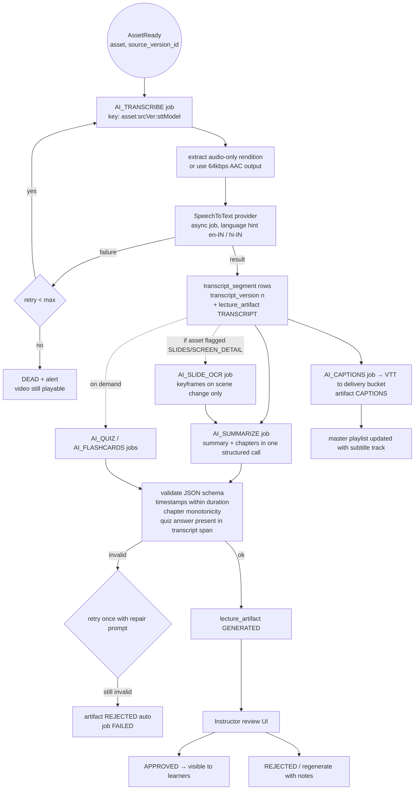

# 07 — AI Processing for Lectures

Status: **Proposed** · 2026-10-21 · All AI integrations are **proposed additions**. Tables: 03 §9–10.

## 1. Principles

1. **Failure isolation:** media `READY` never waits for AI. AI work starts *after* `AssetReady`, runs as separate `processing_job`s, and its failure only affects AI artifacts.
2. **Transcript-first:** every text artifact is derived from the transcript (cheap, fast). Visual analysis is selective and opt-in.
3. **Versioned, attributable outputs:** each artifact records the asset `source_version_id`, transcript version, provider, model, prompt template version and usage/cost.
4. **Humans approve learning material:** summaries, chapters, quizzes and flashcards are drafts until an instructor approves (per-org setting can auto-publish captions/summaries).
5. **Access-scoped retrieval:** Q&A only retrieves from assets the asker may play.

## 2. Capabilities and value

| # | Capability | Default | Approval | Notes |
|---|---|---|---|---|
| 1 | Timestamped transcription | On | — | Basis for everything else |
| 2 | Captions (WebVTT) | On | Auto-publish (org may require review) | Accessibility; generated from transcript segments |
| 3 | Lecture summary | On | Instructor | Short + detailed |
| 4 | Timestamped chapters | On | Instructor | Navigation in player |
| 5 | Searchable transcript | On | — | Postgres FTS over `transcript_segment.tsv` |
| 6 | Lecture-grounded Q&A | Org setting | — (answers logged & monitored) | Phase 5b, after evaluation |
| 7 | Quiz generation | On demand | **Required** | Drafts into the assessment module |
| 8 | Flashcards | On demand | Instructor | |
| 9 | Key formulas / concepts / definitions | On demand | Instructor | Only "where reliable": requires slide OCR for formula-heavy lectures |
| 10 | Review & approval workflow | — | — | `lecture_artifact.status` GENERATED → IN_REVIEW → APPROVED/REJECTED |

## 3. Pipeline (diagram 8)



Every job has a deterministic `idempotency_key` (`{type}:{assetId}:{sourceVersionId}:{transcriptVersion}:{promptVersion}`), so a duplicate `AssetReady` or a manual retry never produces duplicate artifacts or duplicate spend.

## 4. Provider choices (behind ports)

### Speech-to-text (`SpeechToText` port)
| Option | Notes |
|---|---|
| Amazon Transcribe (batch) | Same AWS account, S3 in/out, async with EventBridge completion, speaker labels, custom vocabulary (course terms). Pricing page reports $0.006/min batch (US East) — **verify for ap-south-1; historically T1 was higher** (11 §3). |
| Self-hosted Whisper-class model on GPU spot | Cheaper at volume, better on Indian English/Hinglish in some tests (unverified for our content), adds GPU ops |
| Other hosted STT APIs | Compare on a 10-lecture benchmark set |

**Decision:** start with Transcribe (ADR-010 consequence), and run a **benchmark of 10 representative lectures** (accents, code-switching Hindi/English, technical vocabulary) before Phase 5 GA; WER and timestamp accuracy decide.

### LLM (`LlmClient` port)
Text generation (summary, chapters, quiz, flashcards, Q&A answers) via a hosted LLM. Using Anthropic's Claude models as the reference provider for costing (pricing cached 2026-10-06, 11 §3):
- **Bulk artifact generation** (offline, not latency-sensitive): Claude Sonnet 5.5 via the **Batch API** (50% discount) for quality-critical items (quiz, summary); Claude Haiku 5.5 for captions clean-up and chapters if evaluation shows parity.
- **Q&A answers** (interactive): Claude Haiku 5.5 by default; escalate to Sonnet 5.5 for low-confidence retrievals or long multi-lecture questions.
- Structured outputs (JSON schema per artifact type) so validation is mechanical. Prompt caching on the transcript prefix when several artifacts are generated from the same lecture.
- The final model choice per task is confirmed by evaluation (Q-15); the port keeps provider portability (Bedrock or another vendor).

## 5. Data model usage

| Table | Usage |
|---|---|
| `processing_job` | One row per AI step; `job_type` AI_*; `result` holds usage numbers; `external_ref` = STT job id |
| `transcript_segment` | 5–10 s segments, `transcript_version` increments on re-transcription (better model, custom vocabulary) |
| `lecture_artifact` | Each generated output (TRANSCRIPT, CAPTIONS, SUMMARY, CHAPTERS, QUIZ_DRAFT, FLASHCARDS, KEY_CONCEPTS); usage + cost; review status |
| `lecture_chapter` | Relational chapters for the player (rows of an approved CHAPTERS artifact) |

No separate `AIArtifactVersion` table: `artifact_version` + `status=SUPERSEDED` on `lecture_artifact` covers versioning. No separate `AIProcessingJob` table: `processing_job` covers it with AI-specific usage in `result`.

Media and AI readiness are separate signals:
- Media: `content_asset.media_status`.
- AI: latest `processing_job` per AI type for the asset + `lecture_artifact` rows. API exposes `aiStatus: {transcript: READY|PROCESSING|FAILED|NOT_REQUESTED, summary: ..., ...}`.

## 6. Versioning rules

- New asset source version (re-upload/replace) → new AI jobs; old artifacts stay attached to the old `source_version_id` and are hidden from learners on versions that use the new asset.
- Re-transcription → `transcript_version+1`; dependent artifacts are marked `SUPERSEDED` only once the instructor approves replacements (learners keep the approved old ones meanwhile).
- Prompt template change → artifacts aren't regenerated automatically (cost control); an admin "regenerate" action creates a new `artifact_version`.

## 7. Lecture-grounded Q&A (design for Phase 5b)

```mermaid
sequenceDiagram
  autonumber
  actor L as Learner
  participant API as Ohara API
  participant CAS as ContentAccessService
  participant DB as PostgreSQL (FTS)
  participant LLM as LLM provider
  L->>API: POST /api/courses/{courseId}/qa {question, lessonId?}
  API->>CAS: check(actor, COURSE, QUERY_AI) + list playable asset ids in pinned version
  API->>DB: FTS over transcript_segment WHERE content_asset_id IN (allowed)<br/>rank ts_rank_cd, windows of ±2 segments, top 8
  alt no hits above threshold
    API-->>L: "Not covered in your course materials" (no LLM call)
  else hits
    API->>LLM: system: answer only from provided excerpts; cite [asset, start_ms]; say if unsupported<br/>user: question + excerpts
    LLM-->>API: answer + citations (structured)
    API->>API: verify every citation maps to a provided excerpt; drop otherwise
    API-->>L: answer, citations (lesson title, timestamp deep-link)
  end
  API->>DB: ai_qa_log (question hash, asset ids, model, tokens, grounded flag) — retention 90 days
```

- **Tenant safety:** the allowed-asset list is computed *before* retrieval from the learner's enrollment/version; the SQL filter is mandatory in the repository method signature (no "search all" method exists). Revocation applies immediately because the check runs per question.
- **Retrieval:** Postgres FTS (`english` config + `simple` for code tokens) first. Evaluate on a question set (Recall@8 for answer-bearing segments). Add **pgvector** embeddings on `transcript_segment` only if FTS recall is inadequate — still in Postgres, still filtered by allowed assets (ADR-010). No separate vector DB.
- **Hallucination controls:** extractive-first prompt, mandatory citations validated server-side, refusal when no context, answer length caps, thumbs up/down feedback, weekly sampled review of low-rated answers by course staff; metric `qa_ungrounded_rate`.
- **Visual content:** for formula/diagram-heavy lectures, add OCR text of keyframes (scene-change detection, ≤ 1 frame/30 s) as extra retrievable segments with timestamps. Multimodal analysis of every frame is explicitly not done by default (cost, 11 §5).
- **Abuse/cost limits:** per-user 30 questions/day, per-org monthly token budget with alert at 80%.

## 8. Failure handling

| Failure | Behaviour |
|---|---|
| STT provider timeout / 5xx | Retry with exponential backoff + jitter (1, 4, 16, 60 min), max 5; then DEAD + alert; asset playable |
| STT returns empty / very low confidence | Artifact flagged `needs_review`; captions not auto-published |
| LLM invalid JSON / schema mismatch | One repair attempt; then FAILED, visible in admin with error |
| LLM refusal / safety stop | Record `stop_reason`; artifact not created; surface to instructor |
| Duplicate trigger (event replay) | `idempotency_key` unique → no-op |
| Provider outage | Circuit breaker (Resilience4j — finally used) opens; jobs reschedule `run_after` +30 min without consuming attempts |
| Cost runaway | Per-org and global daily spend caps checked before submitting LLM jobs; exceeding → jobs parked `PENDING` with `run_after` next day + alert |

## 9. Cost & usage attribution

Each AI job records `audio_seconds`, `input_tokens`, `output_tokens`, `cache_read_tokens`, `provider`, `model`, `prompt_template_version`, and computed `cost_micro_usd` (rates from versioned application configuration `ohara.ai.pricing.*`, so a price change doesn't require a code change). Q&A calls are recorded in `ai_qa_log` (03 §9.4). Aggregations per asset, course, org and artifact type feed the cost dashboards (`09` §8, `11` §7).
