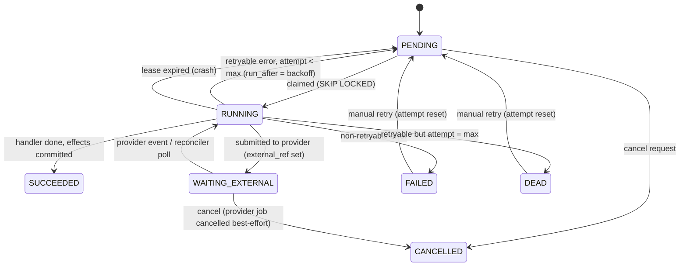
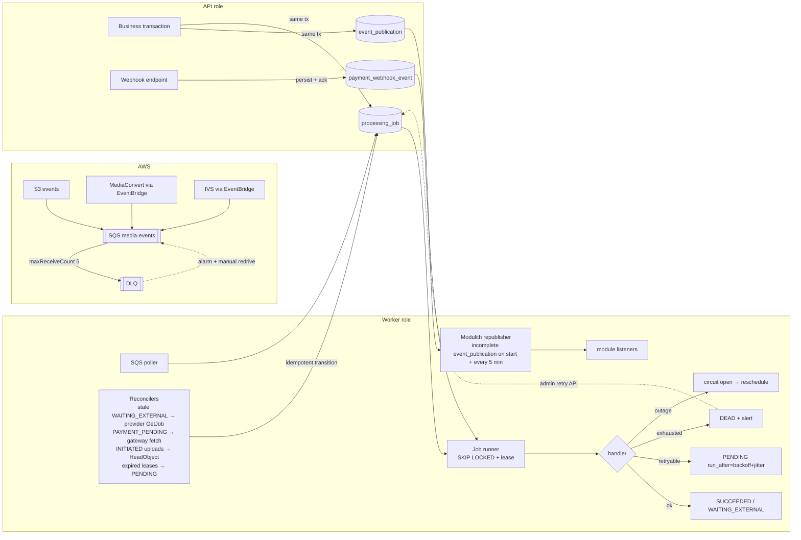

# 09 — Asynchronous Processing and Reliability

Status: **Proposed** · 2026-10-21 · Nothing asynchronous exists today (01 §5). Tables: `processing_job`, `event_publication`, `idempotency_key` (03 §10).

## 1. Building blocks and why each exists

| Mechanism | Used for | Why this and not something else |
|---|---|---|
| **Spring Modulith event publication registry** (JDBC, `spring-modulith-starter-jdbc`) | In-process domain events between modules (`PaymentCaptured`, `CohortMembershipStarted`, `AssetReady`, `OfferingOpened`) | Transactional outbox for free: the event is persisted in the same transaction as the state change and re-delivered on restart if a listener failed. Already on the Modulith stack. |
| **`processing_job` table** | Long or external work: probe/transcode/verify, STT, LLM, bulk import, email, sweeps | Durable, queryable status for UIs ("processing 60%"), retries with backoff, leases, manual retry — all in the DB we already run. |
| **Amazon SQS** (`media-events` + DLQ) | *Inbound* AWS events: S3 ObjectCreated, MediaConvert job state (EventBridge), IVS stream/recording events (EventBridge), Transcribe completion | These producers can only emit to AWS targets; SQS buffers them durably when workers are down. |
| **Polling reconcilers** | Safety net for every external dependency | Events get lost or arrive out of order; reconciling with the provider's API makes the system converge. |
| Not used: Kafka, Step Functions, Redis queues | — | No replay/stream-processing consumer exists yet (Kafka); job graph is shallow and lives in our DB (Step Functions would split state across two systems); Redis isn't durable enough for money/media state. Re-evaluate per ADR-008. |

## 2. Job model

### 2.1 Claiming (worker loop)
```sql
WITH next AS (
  SELECT id FROM processing_job
  WHERE status = 'PENDING' AND run_after <= now() AND job_type = ANY(:types)
  ORDER BY priority, run_after
  LIMIT :batch
  FOR UPDATE SKIP LOCKED)
UPDATE processing_job j
SET status = 'RUNNING', locked_by = :worker, lease_until = now() + :lease, attempt = attempt + 1, updated_at = now()
FROM next WHERE j.id = next.id
RETURNING j.*;
```
- Workers poll every 1 s when busy, backing off to 10 s when idle; `LISTEN/NOTIFY` on insert can wake them earlier (optional).
- Long-running handlers extend `lease_until` (heartbeat). A lease-recovery sweeper resets `RUNNING` jobs whose lease expired to `PENDING` (attempt already counted).

### 2.2 Job state machine



### 2.3 Retry policy
- Classify errors: `RETRYABLE` (timeouts, 429, 5xx, throttling, lease loss), `NON_RETRYABLE` (validation, 4xx except 408/429, unsupported codec), `PROVIDER_OUTAGE` (circuit open → reschedule without consuming an attempt, capped at 24 h).
- Backoff: `run_after = now() + min(cap, base × 2^(attempt-1)) × random(0.5, 1.5)` (full jitter). Defaults: base 30 s, cap 1 h, `max_attempts` 5 (media), 6 (AI), 8 (email), 10 (reconcilers).
- Per-type concurrency limits (semaphores per worker + global limit via a `job_type_limit` setting): e.g. `MEDIA_TRANSCODE` 20 concurrent submissions, `AI_SUMMARIZE` 4, `EMAIL_SEND` 10. Prevents provider throttling and runaway spend.
- Bounded everything: no unbounded executors, no infinite retries.

## 3. Idempotency (at-least-once everywhere, idempotent effects)

We never claim exactly-once. Every handler is written so that running it twice has the same effect as once:

| Layer | Technique |
|---|---|
| Job creation | `processing_job.idempotency_key UNIQUE` → `INSERT ... ON CONFLICT DO NOTHING` |
| Domain effects | Natural unique keys: `enrollment(user_id, course_offering_id)`, `access_grant(source, source_ref_id)`, `payment_transaction(gateway, gateway_payment_id, type)`, `content_asset(live_session_id)`, `media_rendition(asset, generation, kind, height, language)`, `lecture_artifact(asset, type, version)` |
| State transitions | Conditional updates: `UPDATE content_asset SET media_status='READY' WHERE id=? AND media_status='PROCESSING' AND processing_generation=?` — stale or duplicate events affect 0 rows |
| External submissions | Provider client tokens: MediaConvert `ClientRequestToken` = job id; Transcribe job name = job id; payment gateway order `receipt` = order id |
| HTTP | `Idempotency-Key` table for client POSTs (08 §1.5) |
| Inbound SQS / webhooks | Dedupe by provider event id (`payment_webhook_event` unique; SQS handler checks job/asset state before acting) |
| Emails | `EMAIL_SEND` key = `{template}:{subjectId}:{purpose}` → no duplicate "welcome" mails on retries |

## 4. SQS consumption

- Long polling (20 s), batch 10, visibility timeout 5 min (> max handler time). Handlers are short: they translate the event into a job transition and commit; heavy work happens in jobs.
- Delete the message only after the DB commit. Crash before delete → redelivery → idempotent handler no-ops.
- `maxReceiveCount = 5` → **DLQ** `media-events-dlq` (retention 14 days). Alarm on DLQ depth > 0. Admin can redrive after fixing.
- **Poison messages** (unparseable/unknown asset): logged with message id, moved to DLQ after retries; never block the queue (standard queue, not FIFO — ordering isn't relied upon; state guards handle reordering).

## 5. Failure scenarios

| Scenario | What happens |
|---|---|
| **S3 upload succeeds but `complete` call never reaches the backend** | Multipart: object doesn't exist until `CompleteMultipartUpload`; the API calls that, so if the *client* never calls `complete`, the upload expires (lifecycle abort + sweeper → `CANCELLED`, user can resume within 24 h via `ListParts`). If the API completed at S3 and then crashed before committing, `ObjectCreated` → SQS → handler finds `media_upload` by `object_key` in `INITIATED`, verifies via `HeadObject`, and performs the same transition. Single-PUT uploads (≤ 100 MB) rely on the same event + a sweeper that `HeadObject`s `INITIATED` uploads older than 1 h. |
| **Worker finishes transcoding but crashes before recording success** | MediaConvert keeps the result. On restart: (1) the SQS COMPLETE event is redelivered (not deleted before commit) → handler proceeds; (2) independently, the reconciler finds `WAITING_EXTERNAL` jobs older than their SLA and calls `GetJob(external_ref)`. Verification re-reads S3 outputs, so it's safe to repeat. Asset goes READY exactly once thanks to the conditional update. |
| Worker crashes mid-handler (lease) | Lease expires → job back to `PENDING` → reclaimed; handler idempotent. |
| MediaConvert job ERROR | Retryable codes → resubmit (new generation not needed; same output prefix overwritten); input errors → asset `REJECTED` with reason. |
| Partial outputs (720p missing) | `MEDIA_VERIFY` fails → retry transcode; after max → `FAILED`, alert, admin "reprocess". |
| Provider timeout (STT/LLM) | Retryable with backoff; circuit breaker for sustained failure. |
| Payment webhook arrives before checkout confirm / twice / out of order | Single idempotent `PaymentCaptureHandler`, forward-only order state machine (05 §5). |
| Duplicate `AssetReady` | AI jobs keyed by source version → no duplicates. |
| Cancellation | User/admin cancel: `PENDING` → `CANCELLED`; `WAITING_EXTERNAL` → best-effort provider cancel then `CANCELLED`; late provider events for cancelled jobs are ignored (state guard). |
| Bulk import crash mid-file | Chunked commits; rows already `INVITED/CREATED` are skipped on resume. |
| Database failover (RDS Multi-AZ) | In-flight transactions fail → HTTP 503/retry; jobs resume from committed state; SQS buffers events. |

## 6. Reliability architecture (diagram 11)



## 7. Java 21 / virtual threads

- `spring.threads.virtual.enabled=true` is already set: Tomcat request handling and `@Async`/scheduler executors use virtual threads. Good fit for the API role: requests are dominated by blocking JDBC and HTTP calls to providers (presign is local; IVS/gateway calls are network I/O).
- **Bound what virtual threads don't bound:** the JDBC pool (Hikari, e.g. 20 per API node) is the real concurrency limit — add a semaphore for provider calls (e.g. max 50 concurrent gateway/IVS calls per node) so a provider slowdown can't pin all requests waiting for connections.
- Workers: one virtual thread per claimed job, with per-type semaphores (§2.3). Claim batch size ≤ free permits, so we never claim more than we can run (no unbounded task submission).
- Avoid pinning: no `synchronized` around blocking I/O in our code (use `ReentrantLock`); JDBC driver (pgjdbc ≥ 42.6) is virtual-thread friendly.
- CPU-heavy work (transcoding, ML) never runs in the JVM; it's MediaConvert/IVS/providers. Lightweight CPU work (CSV parsing of ≤ 5,000 rows, playlist parsing) is fine on workers.
- Experiment called for by `initial_prompt.md`: compare platform `ThreadPoolExecutor(16)` vs virtual-thread-per-task for `EMAIL_SEND` and `MEDIA_VERIFY` (I/O-bound) under load; expect equal throughput at low concurrency and lower memory/latency at high concurrency for virtual threads, and no gain for CPU-bound parsing.

## 8. Observability (metrics, dashboards, alerts)

Stack: Micrometer (already via Actuator) → CloudWatch (or Prometheus/Grafana if preferred); structured JSON logs with `traceId`; Modulith observability spans for module events. No new heavyweight platform.

| Area | Metrics | Alerts (initial thresholds) |
|---|---|---|
| Registration | `auth.register{result}`, `auth.verify{result}`, `auth.login{result}`, `auth.duplicate_signup`, `invite.accept{result}`, `invite.send_fail` | login failure rate > 30% for 10 min (stuffing); email send failures > 5% |
| Enrollment & access | `enrollment.created{channel}`, `grant.revoked{reason}`, `access.decision{result,reason}`, `access.cross_tenant_denied` | **any** `cross_tenant_denied` spike > 10/min; `access.decision{deny}` ratio jump |
| Payments | `checkout.started/paid/failed`, `webhook.received{gateway,valid}`, `reconcile.fixed` | invalid signature webhooks > 0; paid-without-grant > 0 after 5 min |
| Uploads/media | `upload.completed_ratio`, `asset.time_to_ready` (p50/p95), `transcode.duration`, `media.failed`, `job.retries{type}` | time_to_ready p95 > 2× duration + 15 min; failed > 5%/day |
| Jobs | `job.backlog{type,status}`, `job.age_oldest_pending{type}`, `job.dead{type}`, SQS `ApproximateNumberOfMessagesVisible`, DLQ depth | DLQ > 0; dead > 0; oldest pending > 30 min |
| AI | `ai.backlog`, `ai.tokens{model,type}`, `ai.audio_minutes`, `ai.cost_usd{org}`, `qa.ungrounded_rate` | daily AI spend > budget × 0.8 |
| Playback | `playback.session_created`, `playback.denied{reason}`, client errors `playback.error{code}`, startup time (client-reported) | error rate > 2% |
| Live | `live.sessions{scheduled,started,missed}`, `live.concurrent_viewers`, `live.viewer_hours`, `live.join_fail`, `live.recording_ready_latency` | session scheduled but not live at +10 min; recording not ready at +2 h |
| Cost | CloudFront `BytesDownloaded` by distribution, IVS output hours, MediaConvert minutes, S3 storage growth; daily estimated cost (Cost Explorer/Budgets) | AWS Budgets at 50/80/100% of monthly plan; anomaly detection on CloudFront bytes (sudden 3× day-over-day) |

Dashboards: (1) Learner funnel, (2) Media pipeline health, (3) Live operations, (4) Cost & usage by org/course, (5) Security (auth failures, cross-tenant denials, webhook signatures).
