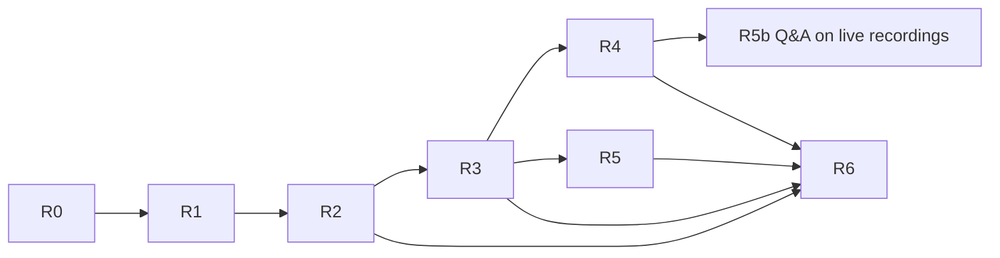

# 12 — Implementation Roadmap

Status: **Proposed** · 2026-10-21

## 0. Numbering reconciliation

`docs/prompts/initial_prompt.md` (moved from `src/main/resources`) numbers the project's own phases: 1 Foundation ✅, 2 User + Auth ✅, 3 Course + Content + Enrollment, 4 Video metadata + progress, 5 S3/MediaConvert/CloudFront, 6 Cart + Redis, 7 Order/checkout, 8 Payments, 9 Async imports, 10 Kafka/Debezium, 11 Virtual-thread experiments, 12 Observability.

This roadmap uses the architecture prompt's **R0–R6** and maps to them:

| Roadmap | Covers original phases | Notes |
|---|---|---|
| R0 Assessment & design | — | This document set |
| R1 Identity & institutional foundation | (2 hardening) + 9 (imports) | |
| R2 Catalog, enrollment, staff-granted B2C access | 3, 4 (progress) | **Cart (6), Order/checkout (7) and Payments (8) are dropped**: payments and refunds are handled offline by the contract team via bank transfer (ADR-012) |
| R3 Video upload & playback | 4, 5 | |
| R4 Live classes | new | |
| R5 AI learning features | new | |
| R6 Scale, cost & hardening | 11, 12 | Kafka/Debezium (10) only if a trigger in ADR-008 fires |

Each phase ships behind mock adapters first, then real providers in a `dev` AWS account.

---

## R0 — Repository assessment and design (this deliverable)
- **Objective:** agreed architecture, schema and roadmap.
- **Done when:** docs 01–14 reviewed; open questions Q-01…Q-08 (13) answered or explicitly deferred; ADRs accepted.
- **Out of scope:** code changes.

## R1 — Identity and institutional foundation

**Status (2026-10-22): complete** on branch `r1-identity-foundation` — slices 1–6 (error model + identity hardening, verification/reset/lockout, durable jobs + email outbox, organizations/cohorts, invitations + bulk import, rate limiting + consents). Deferred: audit_event, ETag/If-Match, account deactivation/deletion flows, college SSO.
- **Objective:** one identity per human, verified email, org/cohort model, org-scoped authorization, invitations, bulk import.
- **Dependencies:** R0; email provider choice (Q-06) — mock until then.
- **DB:** V3 identity hardening, V4 organization, V8 platform (`processing_job`, `idempotency_key`, `audit_event`, Modulith `event_publication`).
- **API:** 08 §2 and §3.
- **Infra:** none mandatory (mock email); add `spring-modulith-starter-jdbc`; Testcontainers for ITs.
- **Tasks:**
  1. Problem-details error model + typed exceptions; replace `IllegalArgumentException` usage (D3).
  2. `TIMESTAMPTZ`/`Instant` migration; RESTRICT FKs; statuses; `lower(email)` index (D1, D4).
  3. JWT `sub`=userId, `ver`, `scope`; `CurrentActor`; access TTL 15 min; `auth_version` check (D2, D11).
  4. Verification, resend, forgot/reset, logout-all, lockout/rate limit (D13).
  5. `organization` module: orgs, memberships, cohorts, invitations, `OrgAuthorizationService`.
  6. Job runner (claim/lease/backoff/DLQ semantics) + `EMAIL_SEND` + sweepers.
  7. Bulk import (validate → confirm → process, error report).
  8. Account deactivation/deletion/anonymization jobs; consent records.
  9. Move secrets out of yml (D6); move prompt docs out of `src/main/resources` (D7).
- **Testing:** unit tests per flow; Testcontainers Postgres ITs (fixes D12); tenant-isolation fixture (org A/B) started here; `ModularityTests` must pass with new modules.
- **Acceptance criteria:**
  - Registering an existing email returns the same response as a new one and sends a notice email (mock captures it).
  - Unverified users can't access non-preview content or receive staff grants (verified by test).
  - An invited learner with an existing account joins without a new `users` row; email mismatch → 409.
  - Removing a learner from a cohort leaves `cohort_membership` with `left_at` set and no deleted rows.
  - Import of 5,000 rows with 3% invalid completes with an error report; re-running after a forced crash produces no duplicates.
  - Cross-org requests on every R1 endpoint return 404.
- **Risks:** auth refactor regressions → keep `AuthFlowIntegrationTest` green throughout; token claim change logs everyone out once (acceptable pre-launch).
- **Out of scope:** SSO/SAML, custom roles, SMS OTP.

## R2 — Course catalog, enrollment and staff-granted B2C access

**Status (2026-10-31): complete** on branch `r2-courses-enrollment` — slice 1 catalog & versioned curriculum, slice 2 offerings/enrollment/grants/ContentAccessService, slice 3 progress & version migration. Deferred: public B2C catalog API, minor-publish auto-migration, nightly EXPIRED marking (access already ends by grant window), document assets (R3).
- **Objective:** courses with versions, curriculum, B2B offerings, B2C access granted by the contract team after offline payment, `ContentAccessService`, progress.
- **Dependencies:** R1 (orgs, cohorts, jobs, outbox). `content_asset` table exists (V6) but only documents/images upload here; videos in R3.
- **DB:** V5 catalog, V6 content, V7 enrollment (incl. `access_grant.external_reference`, `ROLE_ENROLLMENT_MANAGER`).
- **API:** 08 §4, §5 (+ document assets from §6).
- **Infra:** S3 for documents (or mock storage).
- **Tasks:** course/version/module/lesson/content CRUD with draft immutability trigger; publish checklist; offerings & fan-out listener; enrollment + grants; `ContentAccessService` with `checkMany`; progress API; staff grant / extend / revoke endpoints + `GRANT_ACCESS` bulk import + reconciliation CSV export; version migration.
- **Testing:** property tests for reorder; publish/immutability tests; entitlement matrix tests (10 §9); staff-grant tests (role restriction, mandatory reference, idempotent resubmit, revoke → playback denied).
- **Acceptance criteria:**
  - Publishing v2 leaves existing enrollments on v1; new enrollees get v2; migration preserves completion by `lesson_key`.
  - Deleting a lesson never deletes an asset; deleting a referenced asset → 409.
  - The same grant submitted 5× (same Idempotency-Key) creates exactly one enrollment and one `access_grant`; a grant without `externalReference` is rejected.
  - Only `ROLE_ENROLLMENT_MANAGER`/platform admin can grant B2C access; every grant/revoke appears in the reconciliation export with staff member and reference.
  - A user with B2B and B2C enrollments sees both, with channel shown; revoking the B2B one leaves B2C access intact.
  - `ContentAccessService` p95 < 10 ms on a seeded DB of 50k enrollments.
- **Risks:** curriculum versioning complexity → keep "minor publish" out until needed; contract-team process for typo'd emails (revoke + re-grant) documented.
- **Out of scope:** any online payment, checkout, cart or gateway; subscriptions; coupons/promotions engine, certificates, assessments/question banks (separate module later).

## R3 — Video upload, processing and playback

**Status (2026-10-31): complete against local stand-ins** — slice 1 assets & direct uploads, slice 2 probe/ladder/transcode/verify pipeline, slice 3 playback sessions with signed-cookie delivery. Remaining for production: S3, MediaConvert and CloudFront adapters + IaC (needs the AWS account, Q-04), thumbnails, captions (with R5), concurrent-stream limit.
- **Objective:** direct-to-S3 multipart upload, durable pipeline, MediaConvert HLS, CloudFront signed-cookie playback, resume.
- **Dependencies:** R2 (lessons, `ContentAccessService`); AWS account with S3, MediaConvert, CloudFront, SQS, EventBridge, Secrets Manager (Q-04).
- **DB:** `media_upload`, `media_rendition` (V6 if not already), job types.
- **API:** 08 §6.
- **Infra (IaC — Terraform or CDK):** two buckets + lifecycle + BPA; CloudFront distribution with OAC, key group, Origin Shield, WAF, alias `media.<domain>`; MediaConvert role + job template(s); EventBridge rules → SQS `media-events` + DLQ; IAM roles for api/worker.
- **Tasks:** `ObjectStorage`, `Transcoder`, `CdnSigner`, `MediaEventSource` ports + mock + AWS adapters; upload endpoints; probe/transcode/verify jobs; reconcilers; playback session + refresh; player integration guide (hls.js); captions placeholder (VTT from R5); progress heartbeats wired to player.
- **Testing:** mock end-to-end locally; dev-AWS smoke test with 3 sample lectures (720p, 1080p, 4:3 low-res); chaos: kill worker after MediaConvert completes → asset still becomes READY once; expired cookie → refresh → continues.
- **Acceptance criteria:**
  - 2 GB upload resumes after a browser refresh mid-upload.
  - READY only after verify; a deliberately corrupted output stays non-READY and retries.
  - Direct S3 object URL and an expired cookie both return 403; another asset's path with a valid cookie returns 403.
  - Revoking a grant blocks playback within ≤ 20 min (cookie TTL) and immediately on refresh.
  - Time-to-ready p95 ≤ 1× video duration + 15 min for 1-hour lectures.
  - Measured GB per viewer-hour on the default ladder reported (feeds 11).
- **Risks:** cookie domain/mobile player constraints (Q-11); MediaConvert Basic-tier caption limits (sidecar VTT test on iOS).
- **Out of scope:** DRM, offline downloads, per-user watermark.

## R4 — Live classes

**Status (2026-10-31): R4 complete against a local stand-in.** Slice 2 added recordings adopted into the R3 pipeline as library videos with no transcode, replay for the cohort, and reminder and cancellation emails. Remaining for production: the IVS adapter, EventBridge intake and recording configuration (needs the AWS account, Q-04), stream-key rotation, peak viewers, stitching multi-part recordings, and an org time zone.

**Slice 1:** It covers scheduling with host and cohort overlap constraints, per-cohort channels, ingest settings, provider stream events with a reconnect grace and a sweeper, join authorization through `ContentAccessService.offeringAccess`, playback and chat tokens, heartbeat attendance, settlement and manual overrides. - **Objective:** schedule, broadcast, join, chat, attendance, recordings into the VOD pipeline.
- **Dependencies:** R3 (pipeline, asset model); IVS + IVS Chat enabled; playback key pair.
- **DB:** V9 live.
- **API:** 08 §8.
- **Infra:** IVS channels (pool per cohort), recording configuration → source bucket, EventBridge rules for IVS events → SQS, playback key in Secrets Manager.
- **Tasks:** `LiveStreamingProvider` port + mock + IVS adapter; scheduling with overlap constraint; provisioning job T-30; ingest credentials; join tokens; chat tokens & moderation; heartbeats & attendance finalisation; recording registration + adopt path; publishing recording to lesson; notifications (reminders).
- **Testing:** load test 500 simulated viewers (token issuance, heartbeats: ~8 writes/s); IVS dev channel end-to-end with OBS; missing-event recovery (drop Stream End → reconciler ends session).
- **Acceptance criteria:**
  - A learner outside the cohort can't obtain a playback or chat token (404/403).
  - Attendance report for a 60-min session matches expected PRESENT/PARTIAL/ABSENT within ±1 min per learner.
  - Recording becomes a READY lesson asset ≤ 1 h after session end, with no MediaConvert job in the adopt path.
  - Host cannot be double-booked.
- **Risks:** IVS India latency/quality (pilot with one cohort first); classroom networks blocking RTMPS (offer browser broadcast SDK).
- **Out of scope:** two-way video, breakout rooms, polls (can ride chat later).

## R5 — AI learning features

**Status (2026-10-31): slice 1 complete against a local stand-in.** It covers automatic transcription of every READY video and recording (idempotent per source, retries, cost recorded), versioned transcripts, WebVTT captions in playback, review of low-confidence output, and full-text transcript search limited to what the learner may open. **Slice 2 complete (2026-10-31):** the `LlmClient` port, automatic summary and chapters, on-demand quiz and flashcard drafts, strict validation with one repair, refusal handling, staff edit/approve/reject, and the learner study endpoint. **5b complete (2026-10-31):** grounded Q&A with the allowed videos fixed before retrieval, NOT_COVERED without a model call, citation checks by the server, a per-user daily limit, a hashed question log with feedback and 90-day retention, and the evaluation endpoint. **R5 is complete against local stand-ins.** Remaining for production: real STT and LLM adapters (Q-04, Q-15), the 10-lecture STT benchmark and the Q&A evaluation set, org-level AI settings and budgets (Q-16). Real STT and LLM adapters wait on the AWS account and the provider decision (Q-04, Q-15).
- **Objective:** transcripts, captions, summaries, chapters, searchable transcripts, quiz/flashcard drafts with review; Q&A after evaluation.
- **Dependencies:** R3 (`AssetReady`), STT benchmark done (Q-15), LLM provider agreement.
- **DB:** V10 ai (+ `ai_qa_log` in 5b).
- **API:** 08 §6 (transcript/artifacts), §7.
- **Tasks:** `SpeechToText`, `LlmClient` ports + mocks; AI_* jobs with idempotency keys; JSON-schema validation & repair; review UI endpoints; VTT generation + master playlist update; FTS search; cost recording + budgets; **5b:** Q&A with allowed-asset retrieval, citations validation, feedback, evaluation harness.
- **Testing:** golden-file tests for VTT/chapters; schema-validation tests; failure isolation test (STT down → video plays, AI job DEAD, alert); Q&A eval set (≥ 100 questions per pilot course) measuring grounded rate and Recall@8; tenant test: Q&A never cites an asset of another org.
- **Acceptance criteria:**
  - Video playback unaffected by any AI failure (test).
  - Re-triggering AI on the same source version creates no new artifacts or spend.
  - Learners see only APPROVED (or auto-published) artifacts.
  - Q&A: ≥ 90% answers cite valid timestamps on the eval set; 0 cross-tenant citations; "not covered" returned without LLM call when retrieval is empty.
- **Risks:** STT quality on Hinglish/technical terms; LLM cost from Q&A abuse → caps.
- **Out of scope:** pgvector (unless eval demands), multimodal frame analysis by default, auto-grading.

## R6 — Scale, cost and operational hardening

**Status (2026-10-31): slice 1 (audit trail) complete.** It provides the append-only `audit_event` table, the audited actions listed in 10, cross-tenant denial records, and org and platform audit views. **Next in code:** `ETag`/`If-Match` on mutable admin resources, account deletion and anonymization (04 §3.10), and metrics and alerts (Micrometer/Prometheus, 09 §8). The infrastructure work (load tests, DR drill, pentest, autoscaling) needs the AWS environment.
- **Objective:** confidence at 5k B2B + 5k B2C with predictable cost.
- **Tasks:** dashboards & alerts (09 §8); cost attribution job (11 §8); autoscaling policies; S3 lifecycle verification; CDN cache-hit tuning; load tests (playback session creation 200 rps, heartbeats 300 rps, live join burst 500 in 60 s, staff bulk grant of 2,000 rows); tenant-isolation suite expanded to all endpoints; DR drill (RDS PITR restore, SQS redrive, worker crash); security review + external pentest; virtual-thread vs platform-thread experiment (09 §7); evaluate RLS (ADR-002) and Kafka trigger (ADR-008).
- **Acceptance criteria:** SLOs met under load (API p95 < 300 ms for non-provider calls; playback session p95 < 200 ms); restore drill RPO ≤ 5 min / RTO ≤ 1 h; zero high/critical pentest findings open; monthly cost within ±20% of the 11 model for observed usage.
- **Out of scope:** multi-region, microservice extraction.

## Dependency graph

## Cross-cutting definition of done (every phase)
Flyway migration + `ddl-auto: validate` passes; `ModularityTests` green; unit + Testcontainers ITs; tenant-isolation tests for new endpoints; metrics + alerts for new flows; API docs updated (08); ADR added for any new decision; no secrets in repo.
